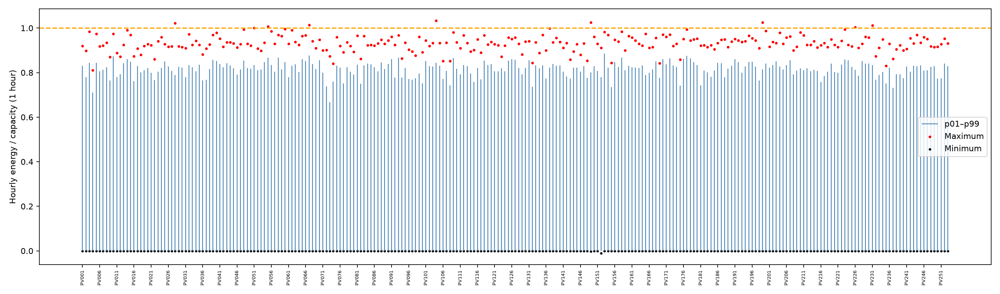
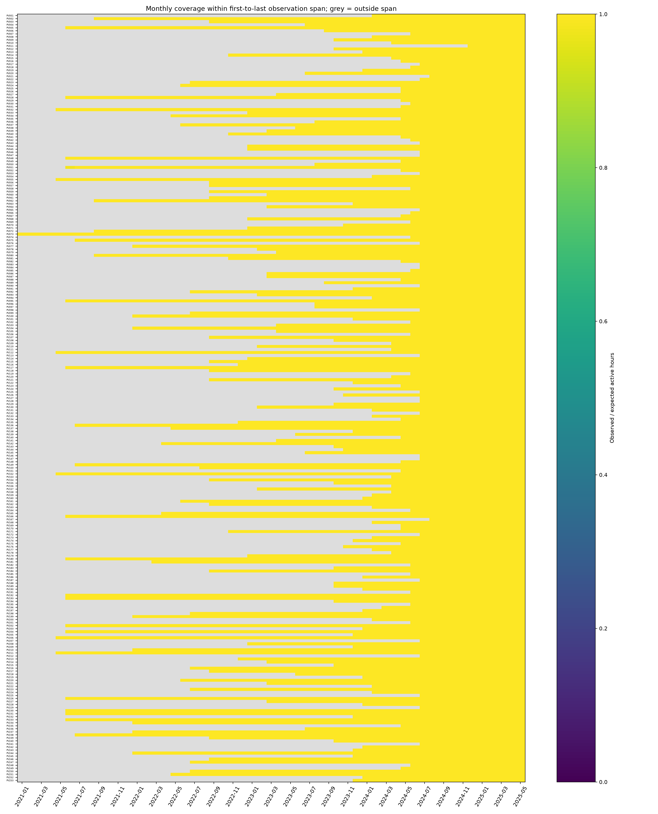
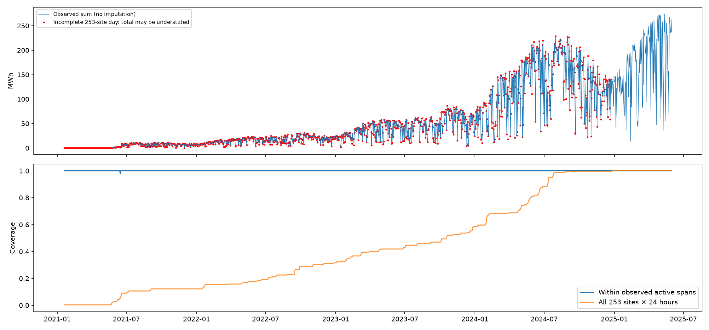

# 2026 OIBC 첫 데이터 품질 EDA

## 분석 기준

입력은 `sites.csv`, `train/generation.parquet`만 사용했다. KST, 우측닫힘 1시간 발전량(kWh)이다. 최초~최종 관측 사이의 매시간을 기대 관측으로 두고 유한 발전량이 있는 시각을 관측으로 센다. 결측률 = 1 − 유한 관측 시간 / 기대 시간. 행 수와 유효 관측 수를 별도로 저장했다. 중복 키 0개, 비유한 발전량 0개이며 중복 발견 시 코드는 중단한다.

최초 관측 전은 **편입 전 추정·상태 불명**, 최종 관측 후는 **관측 종료 후·상태 불명**이다. 실제 편입/폐쇄일이 없으므로 이를 확정하지 않으며 운영 중 결측률의 분모에서 제외한다. 최초~최종 사이는 운영 구간의 대리 지표로 사용하며 통신 장애와 실제 운영 중단을 구분할 수 없다. 전체 비교 시간축은 두 입력에서 확인되는 2021-01-19 13:00:00+09:00 ~ 2025-06-01 00:00:00+09:00이며 공식 학습 시작 이전/이후를 추측해 확장하지 않았다.

일별 집계는 `(ts − 1ns)`의 KST 날짜를 사용하여 00시를 전날에 배정한다. 첫날은 자료가 중간에 시작하는 경계일이다. 결측 발전량은 0으로 채우지 않았고, 전부 결측인 일 합계는 NaN이다. 일부만 있는 날의 합계는 **관측 부분합**이며 완전한 총량으로 해석하면 안 된다. 음수 관측도 그대로 보존하므로 부분합을 엄밀한 하한으로 단정하지 않는다.

## 핵심 발견 5개

1. 253개 발전소, 4,392,566행이다. 최초 관측은 2021-01-19 13:00:00+09:00, 가장 늦은 편입 추정은 2024-12-24 15:00:00+09:00로 발전소별 이력이 크게 다르다.
2. 최초~최종 관측 구간 내 결측은 총 7 site-hours, 가중 결측률 0.000159%이다. 편입 전 공백은 여기에 포함하지 않는다. 발전소별 결측률 중앙값 0.00%, 최대 0.02%이다.
3. 음수 발전량 40건, 용량 대비 시간 발전량 비율(CF)>1 관측 9건, >1.2 관측 0건, 최대 CF 1.0340이다. 계측 오류·용량 정의 차이 등을 추가 확인할 후보이며 자동 삭제/클리핑하지 않았다.
4. 일별 전체 1,594일 중 253개소 × 24시간이 모두 있는 날은 158일이다. 관측 활성 구간에서도 누락이 있는 날은 1일이다. 편입 증가와 결측으로 인한 합계 변화가 발전량 추세에 섞인다.
5. 검증 8,760시간에서 사전 관측 이력이 있고 관측률 ≥99%인 발전소는 205개, ≥95%는 205개다. 검증 시작 이전 이력이 없는 신규 발전소는 48개로 별도 평가해야 한다.

## 발전소별 관측과 결측

전 발전소 상세: [site_coverage.csv](data_quality/site_coverage.csv). `pre_first_hours`와 `post_last_hours`는 전체 비교 시간축 기준으로, 내부 결측과 구분한다.

결측률 상위 15개:

| site_id | first_observed | last_observed | total_rows | span_expected_hours | span_missing_rate |
| --- | --- | --- | --- | --- | --- |
| PV051 | 2021-06-15 17:00:00+09:00 | 2025-06-01 00:00:00+09:00 | 34705 | 34712 | 0.0002016593685181256 |
| PV001 | 2024-02-01 12:00:00+09:00 | 2025-06-01 00:00:00+09:00 | 11653 | 11653 | 0.0 |
| PV175 | 2024-05-17 12:00:00+09:00 | 2025-06-01 00:00:00+09:00 | 9109 | 9109 | 0.0 |
| PV162 | 2022-09-16 10:00:00+09:00 | 2025-06-01 00:00:00+09:00 | 23727 | 23727 | 0.0 |
| PV163 | 2024-02-05 16:00:00+09:00 | 2025-06-01 00:00:00+09:00 | 11553 | 11553 | 0.0 |
| PV164 | 2024-06-17 18:00:00+09:00 | 2025-06-01 00:00:00+09:00 | 8359 | 8359 | 0.0 |
| PV165 | 2022-04-29 13:00:00+09:00 | 2025-06-01 00:00:00+09:00 | 27084 | 27084 | 0.0 |
| PV166 | 2021-06-15 15:00:00+09:00 | 2025-06-01 00:00:00+09:00 | 34714 | 34714 | 0.0 |
| PV167 | 2024-08-23 17:00:00+09:00 | 2025-06-01 00:00:00+09:00 | 6752 | 6752 | 0.0 |
| PV168 | 2024-02-01 16:00:00+09:00 | 2025-06-01 00:00:00+09:00 | 11649 | 11649 | 0.0 |
| PV169 | 2024-05-28 11:00:00+09:00 | 2025-06-01 00:00:00+09:00 | 8846 | 8846 | 0.0 |
| PV170 | 2024-05-20 12:00:00+09:00 | 2025-06-01 00:00:00+09:00 | 9037 | 9037 | 0.0 |
| PV171 | 2022-11-03 00:00:00+09:00 | 2025-06-01 00:00:00+09:00 | 22585 | 22585 | 0.0 |
| PV172 | 2024-07-25 17:00:00+09:00 | 2025-06-01 00:00:00+09:00 | 7448 | 7448 | 0.0 |
| PV173 | 2024-02-02 11:00:00+09:00 | 2025-06-01 00:00:00+09:00 | 11630 | 11630 | 0.0 |

## 설비용량 대비 분포와 이상치

CF = energy(kWh) / (capacity_kw × 1h). [발전소별 평균·표준편차·분위수·최솟값·최댓값·이상치 수](data_quality/site_capacity_factor.csv), [이상치 원시 관측](data_quality/anomalous_observations.csv). 0은 실제 관측이며 결측과 다르다. 전 시간 분포에는 야간이 포함된다. >1은 검토 기준, >1.2는 추가 강도 기준이며 물리적으로 확정된 오류 판정이 아니다. 태양광의 주야·계절 혼합 분포에 단순 IQR 규칙을 적용하면 정상 주간 관측까지 이상치로 오인할 수 있다.

CF 최댓값 상위 10개:

| site_id | mean | p50 | p95 | p99 | min | max | negative | cf_gt_1 | cf_gt_1_2 |
| --- | --- | --- | --- | --- | --- | --- | --- | --- | --- |
| PV104 | 0.1672107047354827 | 0.006279434850863423 | 0.7273678702250131 | 0.8435374149659863 | 0.0 | 1.034013605442177 | 0 | 1 | 0 |
| PV149 | 0.16152504741029267 | 0.003968253968253969 | 0.6845238095238095 | 0.8015873015873016 | -0.0019841269841269845 | 1.02596626984127 | 2 | 1 | 0 |
| PV199 | 0.16140513328600686 | 0.007326007326007326 | 0.6928309785452643 | 0.8148927263212988 | 0.0 | 1.0256410256410258 | 0 | 1 | 0 |
| PV028 | 0.15851371963044517 | 0.0 | 0.6680161943319838 | 0.7894736842105263 | 0.0 | 1.0222672064777327 | 0 | 1 | 0 |
| PV067 | 0.18375725695768735 | 0.011205266475243366 | 0.7695917081028069 | 0.8760165277680501 | 0.0 | 1.0131493802086982 | 0 | 1 | 0 |
| PV231 | 0.1617742677406593 | 0.0 | 0.7142857142857143 | 0.8333333333333333 | 0.0 | 1.0119047619047619 | 0 | 1 | 0 |
| PV055 | 0.1653990894560851 | 0.0 | 0.7333333333333333 | 0.8666666666666667 | 0.0 | 1.0065566666666668 | 0 | 1 | 0 |
| PV226 | 0.15662754435911316 | 0.0 | 0.6927710843373495 | 0.8132530120481928 | 0.0 | 1.0040160642570282 | 0 | 2 | 0 |
| PV051 | 0.15702188263938913 | 0.0 | 0.7222222222222222 | 0.8333333333333334 | 0.0 | 1.0 | 0 | 0 | 0 |
| PV137 | 0.16479212314724692 | 0.009037751196172249 | 0.708133971291866 | 0.8229665071770335 | 0.0 | 0.9984051036682615 | 0 | 0 | 0 |

## 월별 관측률과 일별 발전량

월별 분모는 해당 월과 최초~최종 관측 구간의 교집합이다. 회색은 그 구간 밖이며 0%와 다르다. 편입/종료 월은 부분월임에 유의한다. [월별 수치](data_quality/monthly_active_observation_rate.csv).

빨간 점은 253개소 전체의 24시간이 갖춰지지 않은 날이며, 편입 전 공백도 포함한다. 아래 두 관측률은 운영 구간 내부 누락과 고정된 전체 집합의 미관측을 구별한다. 활성 구간 관측률이 100%여도 전체 발전소 총량이 완전하다는 뜻은 아니다.

[일별 전체 부분합·결측 표시](data_quality/daily_fleet_energy.csv), [발전소별 일별 그래프 PDF](data_quality/daily_by_site.pdf), [발전소별 일별 부분합](data_quality/daily_site_energy_kwh.csv), [일별 활성 관측률](data_quality/daily_site_active_coverage.csv). PDF의 빨간 점은 해당 발전소 관측이 24시간보다 적은 날이다.

## 2024-06-01~2025-05-31 검증 가능성

운영일 기준 2024-06-01~2025-05-31은 우측닫힘 시각 **2024-06-01 01:00 ~ 2025-06-01 00:00 KST**, 8,760시간이다. 관측률은 이 전체 구간을 분모로 한다. 비교용 `active_observation_rate`는 검증 구간과 개별 관측 구간 교집합을 분모로 하므로 신규 발전소도 높을 수 있다.

유한 target이 있으면 그 시각에서 평가할 수 있지만, 전체 연간 검증의 대표성과 과거 학습 가능성은 별개다. ≥99%, ≥95%는 분석상 편의 기준이며 대회 공식 기준이 아니다. `observed_before_validation`은 검증 첫 구간 이전 관측이 있는지, `spans_entire_validation`은 양끝을 포괄하는지를 표시한다. 결측을 채워 평가하지 않는다.

상태별 발전소 수: {"existing_ge_99pct": 205, "new_site_partial": 48}.

전체 253개소의 검증 가능성과 관측률:

| site_id | observed_hours | observation_rate | active_observation_rate | observed_before_validation | status |
| --- | --- | --- | --- | --- | --- |
| PV001 | 8760 | 1.0 | 1.0 | True | existing_ge_99pct |
| PV002 | 8760 | 1.0 | 1.0 | True | existing_ge_99pct |
| PV003 | 8760 | 1.0 | 1.0 | True | existing_ge_99pct |
| PV004 | 8760 | 1.0 | 1.0 | True | existing_ge_99pct |
| PV005 | 8760 | 1.0 | 1.0 | True | existing_ge_99pct |
| PV006 | 8760 | 1.0 | 1.0 | True | existing_ge_99pct |
| PV007 | 8318 | 0.9495433789954338 | 1.0 | False | new_site_partial |
| PV008 | 8760 | 1.0 | 1.0 | True | existing_ge_99pct |
| PV009 | 8760 | 1.0 | 1.0 | True | existing_ge_99pct |
| PV010 | 8760 | 1.0 | 1.0 | True | existing_ge_99pct |
| PV011 | 3802 | 0.43401826484018263 | 1.0 | False | new_site_partial |
| PV012 | 8760 | 1.0 | 1.0 | True | existing_ge_99pct |
| PV013 | 8760 | 1.0 | 1.0 | True | existing_ge_99pct |
| PV014 | 8760 | 1.0 | 1.0 | True | existing_ge_99pct |
| PV015 | 8760 | 1.0 | 1.0 | True | existing_ge_99pct |
| PV016 | 8760 | 1.0 | 1.0 | True | existing_ge_99pct |
| PV017 | 7425 | 0.8476027397260274 | 1.0 | False | new_site_partial |
| PV018 | 8271 | 0.9441780821917808 | 1.0 | False | new_site_partial |
| PV019 | 8760 | 1.0 | 1.0 | True | existing_ge_99pct |
| PV020 | 8760 | 1.0 | 1.0 | True | existing_ge_99pct |
| PV021 | 6633 | 0.7571917808219178 | 1.0 | False | new_site_partial |
| PV022 | 7790 | 0.889269406392694 | 1.0 | False | new_site_partial |
| PV023 | 8760 | 1.0 | 1.0 | True | existing_ge_99pct |
| PV024 | 8760 | 1.0 | 1.0 | True | existing_ge_99pct |
| PV025 | 8760 | 1.0 | 1.0 | True | existing_ge_99pct |
| PV026 | 8760 | 1.0 | 1.0 | True | existing_ge_99pct |
| PV027 | 8760 | 1.0 | 1.0 | True | existing_ge_99pct |
| PV028 | 8760 | 1.0 | 1.0 | True | existing_ge_99pct |
| PV029 | 8760 | 1.0 | 1.0 | True | existing_ge_99pct |
| PV030 | 8268 | 0.9438356164383561 | 1.0 | False | new_site_partial |
| PV031 | 8760 | 1.0 | 1.0 | True | existing_ge_99pct |
| PV032 | 8760 | 1.0 | 1.0 | True | existing_ge_99pct |
| PV033 | 8760 | 1.0 | 1.0 | True | existing_ge_99pct |
| PV034 | 8760 | 1.0 | 1.0 | True | existing_ge_99pct |
| PV035 | 8760 | 1.0 | 1.0 | True | existing_ge_99pct |
| PV036 | 8760 | 1.0 | 1.0 | True | existing_ge_99pct |
| PV037 | 8760 | 1.0 | 1.0 | True | existing_ge_99pct |
| PV038 | 8760 | 1.0 | 1.0 | True | existing_ge_99pct |
| PV039 | 8760 | 1.0 | 1.0 | True | existing_ge_99pct |
| PV040 | 8760 | 1.0 | 1.0 | True | existing_ge_99pct |
| PV041 | 8760 | 1.0 | 1.0 | True | existing_ge_99pct |
| PV042 | 8342 | 0.9522831050228311 | 1.0 | False | new_site_partial |
| PV043 | 7359 | 0.8400684931506849 | 1.0 | False | new_site_partial |
| PV044 | 8760 | 1.0 | 1.0 | True | existing_ge_99pct |
| PV045 | 8760 | 1.0 | 1.0 | True | existing_ge_99pct |
| PV046 | 7520 | 0.8584474885844748 | 1.0 | False | new_site_partial |
| PV047 | 7766 | 0.8865296803652968 | 1.0 | False | new_site_partial |
| PV048 | 8760 | 1.0 | 1.0 | True | existing_ge_99pct |
| PV049 | 8760 | 1.0 | 1.0 | True | existing_ge_99pct |
| PV050 | 8760 | 1.0 | 1.0 | True | existing_ge_99pct |
| PV051 | 8760 | 1.0 | 1.0 | True | existing_ge_99pct |
| PV052 | 8760 | 1.0 | 1.0 | True | existing_ge_99pct |
| PV053 | 7811 | 0.8916666666666667 | 1.0 | False | new_site_partial |
| PV054 | 8760 | 1.0 | 1.0 | True | existing_ge_99pct |
| PV055 | 8760 | 1.0 | 1.0 | True | existing_ge_99pct |
| PV056 | 8760 | 1.0 | 1.0 | True | existing_ge_99pct |
| PV057 | 8760 | 1.0 | 1.0 | True | existing_ge_99pct |
| PV058 | 8145 | 0.9297945205479452 | 1.0 | False | new_site_partial |
| PV059 | 8760 | 1.0 | 1.0 | True | existing_ge_99pct |
| PV060 | 8760 | 1.0 | 1.0 | True | existing_ge_99pct |
| PV061 | 8760 | 1.0 | 1.0 | True | existing_ge_99pct |
| PV062 | 8760 | 1.0 | 1.0 | True | existing_ge_99pct |
| PV063 | 8760 | 1.0 | 1.0 | True | existing_ge_99pct |
| PV064 | 8760 | 1.0 | 1.0 | True | existing_ge_99pct |
| PV065 | 7760 | 0.8858447488584474 | 1.0 | False | new_site_partial |
| PV066 | 8361 | 0.9544520547945206 | 1.0 | False | new_site_partial |
| PV067 | 8760 | 1.0 | 1.0 | True | existing_ge_99pct |
| PV068 | 8760 | 1.0 | 1.0 | True | existing_ge_99pct |
| PV069 | 8318 | 0.9495433789954338 | 1.0 | False | new_site_partial |
| PV070 | 8760 | 1.0 | 1.0 | True | existing_ge_99pct |
| PV071 | 8760 | 1.0 | 1.0 | True | existing_ge_99pct |
| PV072 | 8760 | 1.0 | 1.0 | True | existing_ge_99pct |
| PV073 | 8760 | 1.0 | 1.0 | True | existing_ge_99pct |
| PV074 | 8150 | 0.930365296803653 | 1.0 | False | new_site_partial |
| PV075 | 8760 | 1.0 | 1.0 | True | existing_ge_99pct |
| PV076 | 7788 | 0.8890410958904109 | 1.0 | False | new_site_partial |
| PV077 | 8760 | 1.0 | 1.0 | True | existing_ge_99pct |
| PV078 | 8760 | 1.0 | 1.0 | True | existing_ge_99pct |
| PV079 | 8760 | 1.0 | 1.0 | True | existing_ge_99pct |
| PV080 | 8760 | 1.0 | 1.0 | True | existing_ge_99pct |
| PV081 | 8760 | 1.0 | 1.0 | True | existing_ge_99pct |
| PV082 | 8760 | 1.0 | 1.0 | True | existing_ge_99pct |
| PV083 | 7767 | 0.8866438356164383 | 1.0 | False | new_site_partial |
| PV084 | 7784 | 0.8885844748858448 | 1.0 | False | new_site_partial |
| PV085 | 8529 | 0.9736301369863014 | 1.0 | False | new_site_partial |
| PV086 | 8760 | 1.0 | 1.0 | True | existing_ge_99pct |
| PV087 | 8760 | 1.0 | 1.0 | True | existing_ge_99pct |
| PV088 | 8760 | 1.0 | 1.0 | True | existing_ge_99pct |
| PV089 | 8760 | 1.0 | 1.0 | True | existing_ge_99pct |
| PV090 | 7835 | 0.894406392694064 | 1.0 | False | new_site_partial |
| PV091 | 8760 | 1.0 | 1.0 | True | existing_ge_99pct |
| PV092 | 8760 | 1.0 | 1.0 | True | existing_ge_99pct |
| PV093 | 8760 | 1.0 | 1.0 | True | existing_ge_99pct |
| PV094 | 8760 | 1.0 | 1.0 | True | existing_ge_99pct |
| PV095 | 8760 | 1.0 | 1.0 | True | existing_ge_99pct |
| PV096 | 8760 | 1.0 | 1.0 | True | existing_ge_99pct |
| PV097 | 8760 | 1.0 | 1.0 | True | existing_ge_99pct |
| PV098 | 7790 | 0.889269406392694 | 1.0 | False | new_site_partial |
| PV099 | 8760 | 1.0 | 1.0 | True | existing_ge_99pct |
| PV100 | 8760 | 1.0 | 1.0 | True | existing_ge_99pct |
| PV101 | 8760 | 1.0 | 1.0 | True | existing_ge_99pct |
| PV102 | 8359 | 0.9542237442922374 | 1.0 | False | new_site_partial |
| PV103 | 8760 | 1.0 | 1.0 | True | existing_ge_99pct |
| PV104 | 8760 | 1.0 | 1.0 | True | existing_ge_99pct |
| PV105 | 8760 | 1.0 | 1.0 | True | existing_ge_99pct |
| PV106 | 8151 | 0.9304794520547945 | 1.0 | False | new_site_partial |
| PV107 | 8760 | 1.0 | 1.0 | True | existing_ge_99pct |
| PV108 | 8760 | 1.0 | 1.0 | True | existing_ge_99pct |
| PV109 | 8760 | 1.0 | 1.0 | True | existing_ge_99pct |
| PV110 | 8760 | 1.0 | 1.0 | True | existing_ge_99pct |
| PV111 | 8760 | 1.0 | 1.0 | True | existing_ge_99pct |
| PV112 | 8760 | 1.0 | 1.0 | True | existing_ge_99pct |
| PV113 | 7789 | 0.8891552511415525 | 1.0 | False | new_site_partial |
| PV114 | 8760 | 1.0 | 1.0 | True | existing_ge_99pct |
| PV115 | 8760 | 1.0 | 1.0 | True | existing_ge_99pct |
| PV116 | 8760 | 1.0 | 1.0 | True | existing_ge_99pct |
| PV117 | 8760 | 1.0 | 1.0 | True | existing_ge_99pct |
| PV118 | 8760 | 1.0 | 1.0 | True | existing_ge_99pct |
| PV119 | 8317 | 0.9494292237442923 | 1.0 | False | new_site_partial |
| PV120 | 8760 | 1.0 | 1.0 | True | existing_ge_99pct |
| PV121 | 8760 | 1.0 | 1.0 | True | existing_ge_99pct |
| PV122 | 8760 | 1.0 | 1.0 | True | existing_ge_99pct |
| PV123 | 8760 | 1.0 | 1.0 | True | existing_ge_99pct |
| PV124 | 8760 | 1.0 | 1.0 | True | existing_ge_99pct |
| PV125 | 7760 | 0.8858447488584474 | 1.0 | False | new_site_partial |
| PV126 | 8760 | 1.0 | 1.0 | True | existing_ge_99pct |
| PV127 | 7448 | 0.8502283105022831 | 1.0 | False | new_site_partial |
| PV128 | 7454 | 0.8509132420091324 | 1.0 | False | new_site_partial |
| PV129 | 8760 | 1.0 | 1.0 | True | existing_ge_99pct |
| PV130 | 8760 | 1.0 | 1.0 | True | existing_ge_99pct |
| PV131 | 8760 | 1.0 | 1.0 | True | existing_ge_99pct |
| PV132 | 7525 | 0.8590182648401826 | 1.0 | False | new_site_partial |
| PV133 | 8760 | 1.0 | 1.0 | True | existing_ge_99pct |
| PV134 | 8760 | 1.0 | 1.0 | True | existing_ge_99pct |
| PV135 | 8760 | 1.0 | 1.0 | True | existing_ge_99pct |
| PV136 | 8760 | 1.0 | 1.0 | True | existing_ge_99pct |
| PV137 | 8760 | 1.0 | 1.0 | True | existing_ge_99pct |
| PV138 | 8760 | 1.0 | 1.0 | True | existing_ge_99pct |
| PV139 | 8760 | 1.0 | 1.0 | True | existing_ge_99pct |
| PV140 | 8760 | 1.0 | 1.0 | True | existing_ge_99pct |
| PV141 | 8760 | 1.0 | 1.0 | True | existing_ge_99pct |
| PV142 | 8760 | 1.0 | 1.0 | True | existing_ge_99pct |
| PV143 | 8760 | 1.0 | 1.0 | True | existing_ge_99pct |
| PV144 | 8760 | 1.0 | 1.0 | True | existing_ge_99pct |
| PV145 | 8760 | 1.0 | 1.0 | True | existing_ge_99pct |
| PV146 | 7784 | 0.8885844748858448 | 1.0 | False | new_site_partial |
| PV147 | 7814 | 0.8920091324200913 | 1.0 | False | new_site_partial |
| PV148 | 8760 | 1.0 | 1.0 | True | existing_ge_99pct |
| PV149 | 8760 | 1.0 | 1.0 | True | existing_ge_99pct |
| PV150 | 8760 | 1.0 | 1.0 | True | existing_ge_99pct |
| PV151 | 8760 | 1.0 | 1.0 | True | existing_ge_99pct |
| PV152 | 8760 | 1.0 | 1.0 | True | existing_ge_99pct |
| PV153 | 8760 | 1.0 | 1.0 | True | existing_ge_99pct |
| PV154 | 8760 | 1.0 | 1.0 | True | existing_ge_99pct |
| PV155 | 8760 | 1.0 | 1.0 | True | existing_ge_99pct |
| PV156 | 8760 | 1.0 | 1.0 | True | existing_ge_99pct |
| PV157 | 8760 | 1.0 | 1.0 | True | existing_ge_99pct |
| PV158 | 8760 | 1.0 | 1.0 | True | existing_ge_99pct |
| PV159 | 8760 | 1.0 | 1.0 | True | existing_ge_99pct |
| PV160 | 8760 | 1.0 | 1.0 | True | existing_ge_99pct |
| PV161 | 8760 | 1.0 | 1.0 | True | existing_ge_99pct |
| PV162 | 8760 | 1.0 | 1.0 | True | existing_ge_99pct |
| PV163 | 8760 | 1.0 | 1.0 | True | existing_ge_99pct |
| PV164 | 8359 | 0.9542237442922374 | 1.0 | False | new_site_partial |
| PV165 | 8760 | 1.0 | 1.0 | True | existing_ge_99pct |
| PV166 | 8760 | 1.0 | 1.0 | True | existing_ge_99pct |
| PV167 | 6752 | 0.7707762557077625 | 1.0 | False | new_site_partial |
| PV168 | 8760 | 1.0 | 1.0 | True | existing_ge_99pct |
| PV169 | 8760 | 1.0 | 1.0 | True | existing_ge_99pct |
| PV170 | 8760 | 1.0 | 1.0 | True | existing_ge_99pct |
| PV171 | 8760 | 1.0 | 1.0 | True | existing_ge_99pct |
| PV172 | 7448 | 0.8502283105022831 | 1.0 | False | new_site_partial |
| PV173 | 8760 | 1.0 | 1.0 | True | existing_ge_99pct |
| PV174 | 8760 | 1.0 | 1.0 | True | existing_ge_99pct |
| PV175 | 8760 | 1.0 | 1.0 | True | existing_ge_99pct |
| PV176 | 8760 | 1.0 | 1.0 | True | existing_ge_99pct |
| PV177 | 8760 | 1.0 | 1.0 | True | existing_ge_99pct |
| PV178 | 8760 | 1.0 | 1.0 | True | existing_ge_99pct |
| PV179 | 8760 | 1.0 | 1.0 | True | existing_ge_99pct |
| PV180 | 8760 | 1.0 | 1.0 | True | existing_ge_99pct |
| PV181 | 8760 | 1.0 | 1.0 | True | existing_ge_99pct |
| PV182 | 8699 | 0.9930365296803653 | 1.0 | False | new_site_partial |
| PV183 | 8760 | 1.0 | 1.0 | True | existing_ge_99pct |
| PV184 | 8760 | 1.0 | 1.0 | True | existing_ge_99pct |
| PV185 | 8343 | 0.9523972602739726 | 1.0 | False | new_site_partial |
| PV186 | 8760 | 1.0 | 1.0 | True | existing_ge_99pct |
| PV187 | 7479 | 0.8537671232876712 | 1.0 | False | new_site_partial |
| PV188 | 8760 | 1.0 | 1.0 | True | existing_ge_99pct |
| PV189 | 8760 | 1.0 | 1.0 | True | existing_ge_99pct |
| PV190 | 8760 | 1.0 | 1.0 | True | existing_ge_99pct |
| PV191 | 8479 | 0.9679223744292238 | 1.0 | False | new_site_partial |
| PV192 | 8760 | 1.0 | 1.0 | True | existing_ge_99pct |
| PV193 | 8760 | 1.0 | 1.0 | True | existing_ge_99pct |
| PV194 | 8760 | 1.0 | 1.0 | True | existing_ge_99pct |
| PV195 | 8361 | 0.9544520547945206 | 1.0 | False | new_site_partial |
| PV196 | 8760 | 1.0 | 1.0 | True | existing_ge_99pct |
| PV197 | 8760 | 1.0 | 1.0 | True | existing_ge_99pct |
| PV198 | 8760 | 1.0 | 1.0 | True | existing_ge_99pct |
| PV199 | 8760 | 1.0 | 1.0 | True | existing_ge_99pct |
| PV200 | 8760 | 1.0 | 1.0 | True | existing_ge_99pct |
| PV201 | 8359 | 0.9542237442922374 | 1.0 | False | new_site_partial |
| PV202 | 8760 | 1.0 | 1.0 | True | existing_ge_99pct |
| PV203 | 8760 | 1.0 | 1.0 | True | existing_ge_99pct |
| PV204 | 8760 | 1.0 | 1.0 | True | existing_ge_99pct |
| PV205 | 8760 | 1.0 | 1.0 | True | existing_ge_99pct |
| PV206 | 8760 | 1.0 | 1.0 | True | existing_ge_99pct |
| PV207 | 7760 | 0.8858447488584474 | 1.0 | False | new_site_partial |
| PV208 | 8760 | 1.0 | 1.0 | True | existing_ge_99pct |
| PV209 | 8760 | 1.0 | 1.0 | True | existing_ge_99pct |
| PV210 | 8760 | 1.0 | 1.0 | True | existing_ge_99pct |
| PV211 | 8760 | 1.0 | 1.0 | True | existing_ge_99pct |
| PV212 | 7455 | 0.851027397260274 | 1.0 | False | new_site_partial |
| PV213 | 8760 | 1.0 | 1.0 | True | existing_ge_99pct |
| PV214 | 8760 | 1.0 | 1.0 | True | existing_ge_99pct |
| PV215 | 8760 | 1.0 | 1.0 | True | existing_ge_99pct |
| PV216 | 8760 | 1.0 | 1.0 | True | existing_ge_99pct |
| PV217 | 8760 | 1.0 | 1.0 | True | existing_ge_99pct |
| PV218 | 8760 | 1.0 | 1.0 | True | existing_ge_99pct |
| PV219 | 8760 | 1.0 | 1.0 | True | existing_ge_99pct |
| PV220 | 8760 | 1.0 | 1.0 | True | existing_ge_99pct |
| PV221 | 8760 | 1.0 | 1.0 | True | existing_ge_99pct |
| PV222 | 8760 | 1.0 | 1.0 | True | existing_ge_99pct |
| PV223 | 8760 | 1.0 | 1.0 | True | existing_ge_99pct |
| PV224 | 8760 | 1.0 | 1.0 | True | existing_ge_99pct |
| PV225 | 7814 | 0.8920091324200913 | 1.0 | False | new_site_partial |
| PV226 | 8760 | 1.0 | 1.0 | True | existing_ge_99pct |
| PV227 | 8760 | 1.0 | 1.0 | True | existing_ge_99pct |
| PV228 | 8760 | 1.0 | 1.0 | True | existing_ge_99pct |
| PV229 | 7788 | 0.8890410958904109 | 1.0 | False | new_site_partial |
| PV230 | 8760 | 1.0 | 1.0 | True | existing_ge_99pct |
| PV231 | 8760 | 1.0 | 1.0 | True | existing_ge_99pct |
| PV232 | 8760 | 1.0 | 1.0 | True | existing_ge_99pct |
| PV233 | 8760 | 1.0 | 1.0 | True | existing_ge_99pct |
| PV234 | 8760 | 1.0 | 1.0 | True | existing_ge_99pct |
| PV235 | 8760 | 1.0 | 1.0 | True | existing_ge_99pct |
| PV236 | 8760 | 1.0 | 1.0 | True | existing_ge_99pct |
| PV237 | 8760 | 1.0 | 1.0 | True | existing_ge_99pct |
| PV238 | 8760 | 1.0 | 1.0 | True | existing_ge_99pct |
| PV239 | 8760 | 1.0 | 1.0 | True | existing_ge_99pct |
| PV240 | 8760 | 1.0 | 1.0 | True | existing_ge_99pct |
| PV241 | 7474 | 0.8531963470319635 | 1.0 | False | new_site_partial |
| PV242 | 8760 | 1.0 | 1.0 | True | existing_ge_99pct |
| PV243 | 8760 | 1.0 | 1.0 | True | existing_ge_99pct |
| PV244 | 8760 | 1.0 | 1.0 | True | existing_ge_99pct |
| PV245 | 8760 | 1.0 | 1.0 | True | existing_ge_99pct |
| PV246 | 8760 | 1.0 | 1.0 | True | existing_ge_99pct |
| PV247 | 8760 | 1.0 | 1.0 | True | existing_ge_99pct |
| PV248 | 8342 | 0.9522831050228311 | 1.0 | False | new_site_partial |
| PV249 | 8760 | 1.0 | 1.0 | True | existing_ge_99pct |
| PV250 | 8760 | 1.0 | 1.0 | True | existing_ge_99pct |
| PV251 | 8760 | 1.0 | 1.0 | True | existing_ge_99pct |
| PV252 | 8760 | 1.0 | 1.0 | True | existing_ge_99pct |
| PV253 | 8760 | 1.0 | 1.0 | True | existing_ge_99pct |

[검증 상세 CSV](data_quality/validation_site_coverage.csv).

## 모델 학습 시 주의할 점

- 관측된 유한 target만 기본 학습/평가에 사용한다. 편입 전과 내부 누락에 0을 넣으면 야간 및 발전량 수준을 왜곡한다.
- 시간순 분리를 사용하고 검증 관측으로 결측 복원·스케일링·이상치 임계값을 학습하지 않는다. 일별 집계와 경계도 KST 우측닫힘으로 통일한다.
- 신규 발전소는 cold-start 성능을 별도 보고한다. 기존 발전소의 연간 관측률이 높은 집합과 부분 관측 집합을 나누고 발전소별 유효 표본 수도 함께 제시한다.
- 음수/CF 초과를 우선 추적하고, 제거 또는 clipping은 학습 구간에서 근거를 정한 뒤 민감도 분석한다. 평가 target은 임의로 바꾸지 않는다.
- 관측된 시각만의 오차는 결측이 무작위가 아닐 때 편향될 수 있다. 월·시간대별 관측률과 성능을 함께 확인하고, 집합 발전량 평가는 구성원 관측 완전성을 확인한다. 부분 일 합계를 완전한 일 target으로 사용하지 않는다.

## 재현 및 검증

저장소 루트에서 `MPLCONFIGDIR=/tmp/oibc-first-eda-mpl .venv/bin/python analysis/first_eda.py` 실행. 의존성은 기존 `analysis/requirements.txt`의 pandas/numpy/matplotlib/pyarrow를 사용한다. 분석 코드는 두 입력만 읽는다. 실행 전후 SHA-256 일치, 키 유일성, 시간 정렬 단위, 유효 관측 수 보존, 일별 합계와 원관측 총합 일치를 assert로 검증했다. [입력 해시](data_quality/input_hashes.json), [기계 판독 요약](data_quality/summary.json). 원본을 수정하지 않으며 산출물만 덮어쓴다.
