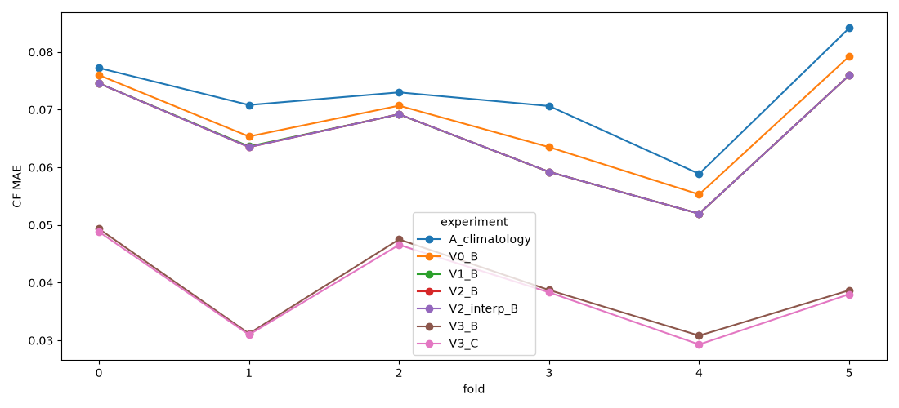
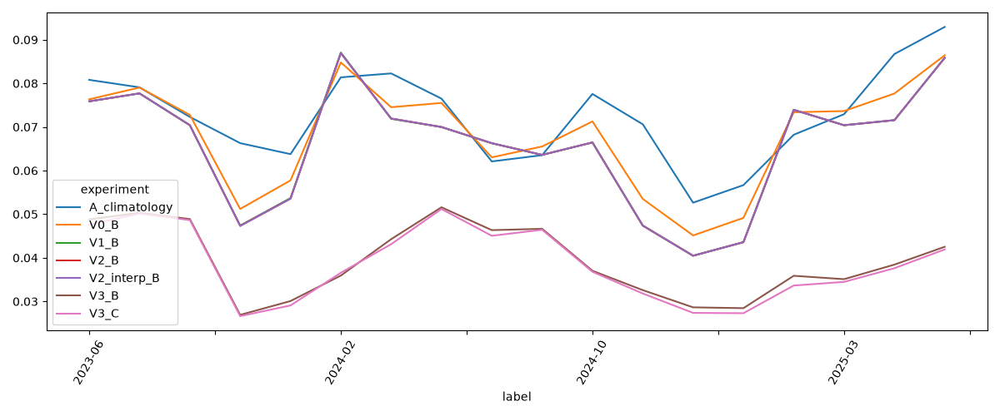
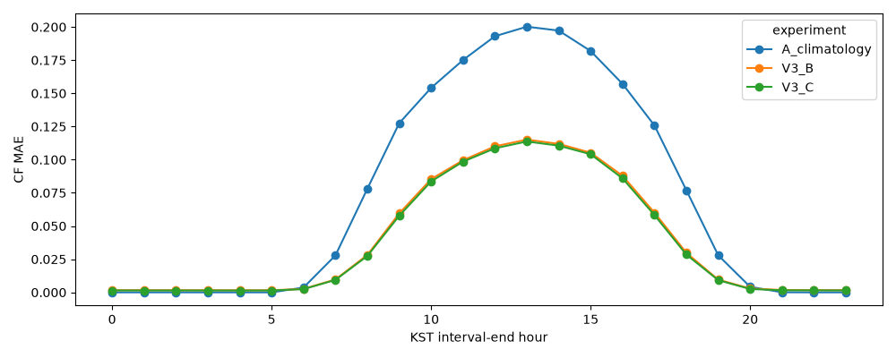
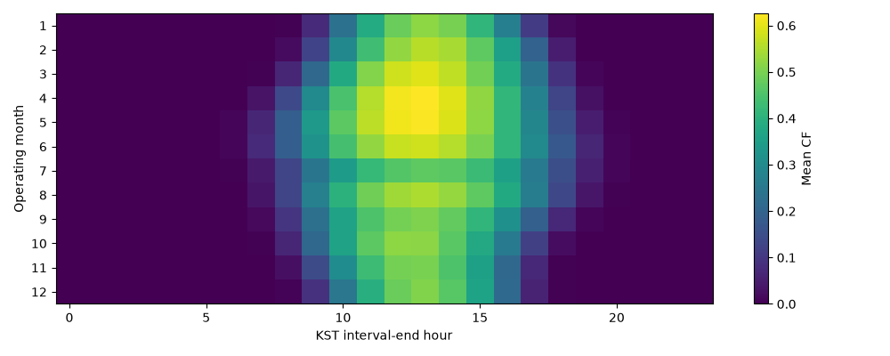
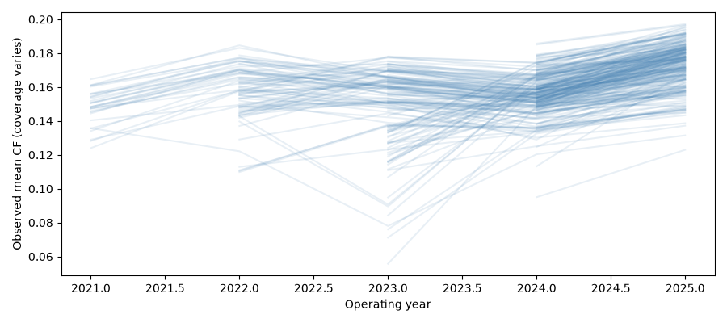
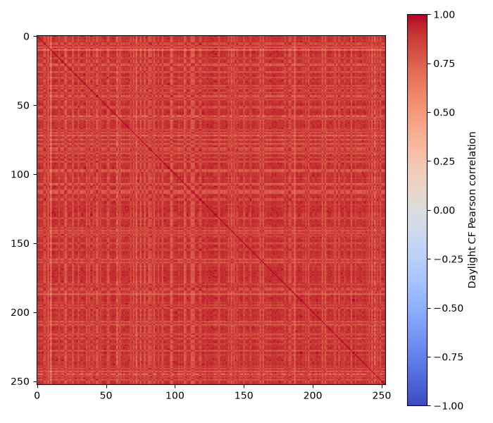

# OIBC expanding 전처리·검증 결과

제공 README의 공식 산식 S=ΣSMP·실적−0.10ΣSMP·k·|예측−실적|을 적용했습니다. 문제정의서 자체는 저장소에서 발견되지 않아 동점 규정 등은 확인하지 못했습니다. 공식 산식 점수는 고정 용량 균형 G1/G2와 전체 253개소 정답이 모두 존재하는 시각만 사용한 로컬 재현값입니다. 기간·평가 마스크가 달라 fold 간 금액을 직접 비교하지 않습니다. 완전 관측 시간이 없는 fold는 official_formula_scores.csv에 행이 없으며 점수를 0으로 해석하면 안 됩니다. 개별 관측 MAE는 별도 보조 지표입니다.

입력 전체 스키마는 schemas.json, 파일 목록은 input_inventory.csv, 기상 변수별 결측·범위는 weather_quality.csv, 실제 간격은 weather_cadence.csv에 있습니다. 단위 정본은 제공 `handover 2/01_participant_dataset/README.md`의 변수 표입니다. A 풍속 m/s, B 풍속 km/h, A 적설 mm/B 적설 cm를 원래 단위로 유지합니다. 예보 round=17은 전일 17시 이용 가능하다고 제공 README가 명시합니다. 실측 기상 수신 지연과 발전 실적 수신 지연은 불명입니다. 실측 기상은 사용하지 않고, 발전 실적은 해당 우측닫힘 시간이 지나면 즉시 이용 가능하다고 가정했습니다. 운영 적용 전 이 가정 확인이 필요합니다.

관측 이전/이후를 채우지 않았습니다. site_valid_periods.csv에 첫·마지막 관측, 실제 관측 수, 내부 공백을 기록했습니다. 관측 시작을 설비 준공일로 해석하지 않습니다. 학습 종료는 각 fold 첫 발행일 17시 이하로 제한했습니다. fold 내 모델은 고정하며 C의 관측 이력만 매 발행 시점으로 갱신합니다. 00시의 운영일은 전일입니다. 원본 음수/CF>1도 유한 실적이면 검증 정답에 그대로 보존했습니다.

V0는 kWh 타깃, V1은 CF 타깃이며 둘은 메타·시간 피처가 같습니다. V2는 음수/CF>1 학습 정답을 제외합니다. V2_interp_B는 정확히 한 시간인 내부 공백만 두 끝점으로 보간하고 오른쪽 끝점이 학습 마감 이전인 경우만 추가합니다. 연속 7시간 공백은 보간 대상이 아닙니다. V3_B는 round17 예보와 제공 좌표로 근사한 시간구간 중앙 태양고도를 추가합니다. V3_C는 raw 관측 기반 48시간 lag와 전일17시까지 168시간 CF 평균·관측 수를 추가합니다. 예보 결측은 LightGBM native missing branch로 처리하며 검증 통계나 미래 기상으로 채우지 않습니다. 실측 기상은 EDA에서만 읽습니다. 음수 예측은 0으로 제한합니다. 용량은 제공 고정 메타값이며 과거 증설 여부는 불명입니다.

A는 fold 이전 발전소·시간대 CF 평균이며 신규 발전소는 전체 발전소 시간대 평균으로 대체합니다. 신규는 학습 관측 2160시간 미만(90일 상당), 기존은 그 이상입니다. 이 기준은 연속 운영기간과 다릅니다. 동일 검증 관측 집합에서 모든 모델을 평가했습니다. 학습 행 제한은 설정에 기록된 고정 등간격 표본이며 시간순 분할에는 무작위성을 사용하지 않았습니다. 하이퍼파라미터는 고정하고 검증 기반 조기 종료를 하지 않았습니다. 이것은 가벼운 baseline 비교로, 전체 학습·튜닝 결과를 의미하지 않습니다.

실험 config.json, 모델 fold*_*.txt, 각 관측 예측 parquet, fits.json과 metrics.csv를 저장했습니다. metrics.csv에는 fold·월·시간·발전소·신규/기존별 MAE가 있습니다. settlement_ledger.parquet에 공식 산식의 시간·집합별 정산 내역을 저장했습니다. 재학습 시 같은 실행 설정을 사용하십시오.

## 관측된 성능 (CF MAE)

| fold | A_climatology | V0_B | V1_B | V2_B | V2_interp_B | V3_B | V3_C |
| --- | --- | --- | --- | --- | --- | --- | --- |
| 0 | 0.077242 | 0.0760064 | 0.0745795 | 0.0745795 | 0.0745795 | 0.0493473 | 0.0488313 |
| 1 | 0.0708221 | 0.0653593 | 0.0636365 | 0.0635186 | 0.0635186 | 0.0311825 | 0.0309875 |
| 2 | 0.0730118 | 0.070707 | 0.0692024 | 0.0692246 | 0.0692246 | 0.0475152 | 0.0465716 |
| 3 | 0.0706457 | 0.0635156 | 0.0592248 | 0.0592248 | 0.0592248 | 0.0387319 | 0.0383268 |
| 4 | 0.0588766 | 0.0553114 | 0.0519631 | 0.0519631 | 0.0519631 | 0.0308278 | 0.029296 |
| 5 | 0.0841646 | 0.0792666 | 0.0759825 | 0.0759825 | 0.0759825 | 0.0386892 | 0.038004 |

## 2025년 3~5월 비교

| other_year | paired_sites | mean_cf_delta | median_cf_delta | ci_low | ci_high | wilcoxon_p | bonferroni_p |
| --- | --- | --- | --- | --- | --- | --- | --- |
| 2021 | 1 | -0.0301035 | -0.0301035 | -0.0301035 | -0.0301035 | 1 | 1 |
| 2022 | 43 | -0.0282186 | -0.0256848 | -0.0323359 | -0.0241862 | 4.54747e-13 | 1.81899e-12 |
| 2023 | 106 | -0.000655649 | -0.00161654 | -0.00379681 | 0.00348685 | 0.0177018 | 0.0708073 |
| 2024 | 189 | -0.00472734 | -0.00281846 | -0.00665491 | -0.00294802 | 2.50025e-10 | 1.0001e-09 |

같은 발전소·월·시간의 양쪽 연도 관측 20개 이상 셀을 맞추고 발전소별 차이를 집계했습니다. 신뢰구간은 발전소 재표집 2000회, p값은 발전소별 paired Wilcoxon 및 4회 Bonferroni입니다. 발전소 공간 상관과 날씨의 연도별 차이가 남아 있으므로 인과 추론이나 산불의 증거가 아닙니다. 제공 데이터의 평균 CF 변화에 대한 탐색 결과입니다. site_year와 year_month 표 및 주간/전체 CF 상관·동시 관측 수를 함께 보십시오. 평균 변화는 일사·기상 차이, 설비 변화, 계측 변화 등을 구분하지 못합니다.

## 검증 및 다음 단계

verification.json과 split_audit.csv는 입력 SHA256 불변, 발행 시각 이전 학습 정답, lag 원천 시각 제한을 검증합니다. 단위 테스트는 경계 00시 운영일, 미래 소스 차단, 첫 검증일 cutoff, 한 시간 보간, 입력 중복 키를 확인합니다. V3_C에서 이후 검증일 이전 실적을 사용하는 것은 매일 관측이 도착하는 rolling-origin 가정입니다. 관측 지연이 확인되면 cutoff에 그 지연을 더 적용해야 합니다.

우선 개선은 발전실적 수신 지연 확인, 모든 학습 행/충분한 트리 수 재실험, fold별 신규 발전소 오차 확인, 예보 10/17 라운드 차이 활용입니다. 통계 차이의 원인은 확인되지 않았고 외부 자료/사전학습 모델은 사용하지 않았습니다. 아래 차이는 이 설정에서 측정한 결과이며 일반적인 향상으로 확정하지 않습니다.

- V0_B: A 대비 fold 평균 CF MAE 차이 -0.004099, 개선 fold 6/6.
- V1_B: A 대비 fold 평균 CF MAE 차이 -0.006696, 개선 fold 6/6.
- V2_B: A 대비 fold 평균 CF MAE 차이 -0.006712, 개선 fold 6/6.
- V2_interp_B: A 대비 fold 평균 CF MAE 차이 -0.006712, 개선 fold 6/6.
- V3_B: A 대비 fold 평균 CF MAE 차이 -0.033078, 개선 fold 6/6.
- V3_C: A 대비 fold 평균 CF MAE 차이 -0.033791, 개선 fold 6/6.

## 직접 비교한 Ablation

| reference | experiment | mean_fold_cf_mae_delta | improved_folds | equal_folds |
| --- | --- | --- | --- | --- |
| V0_B | V1_B | -0.00259627 | 6 | 0 |
| V1_B | V2_B | -1.59194e-05 | 1 | 1 |
| V2_B | V2_interp_B | 0 | 0 | 6 |
| V2_B | V3_B | -0.0263666 | 6 | 0 |
| V3_B | V3_C | -0.000712762 | 6 | 0 |

음수 차이는 개선입니다. 20만 표본은 버전 간 고정했으며 이상치 제외는 그 표본에만 적용했습니다. V2/V3 전체 데이터 파일에서는 모든 이상치가 train_eligible=False입니다.

## 공식 산식 로컬 점수

| fold | experiment | scored_group_hours | score_krw | penalty_krw |
| --- | --- | --- | --- | --- |
| 4 | A_climatology | 3188 | 1.08955e+09 | 8.57699e+07 |
| 4 | V0_B | 3188 | 1.08187e+09 | 9.3453e+07 |
| 4 | V1_B | 3188 | 1.087e+09 | 8.83199e+07 |
| 4 | V2_B | 3188 | 1.087e+09 | 8.83199e+07 |
| 4 | V2_interp_B | 3188 | 1.087e+09 | 8.83199e+07 |
| 4 | V3_B | 3188 | 1.14364e+09 | 3.16839e+07 |
| 4 | V3_C | 3188 | 1.14373e+09 | 3.15945e+07 |
| 5 | A_climatology | 4416 | 2.01722e+09 | 1.90873e+08 |
| 5 | V0_B | 4416 | 2.04257e+09 | 1.65526e+08 |
| 5 | V1_B | 4416 | 2.04148e+09 | 1.66615e+08 |
| 5 | V2_B | 4416 | 2.04148e+09 | 1.66615e+08 |
| 5 | V2_interp_B | 4416 | 2.04148e+09 | 1.66615e+08 |
| 5 | V3_B | 4416 | 2.15506e+09 | 5.30288e+07 |
| 5 | V3_C | 4416 | 2.15479e+09 | 5.33065e+07 |

전체 253개소 관측이 있는 시간에만 계산합니다. 초기 fold의 낮은 관측 범위에서는 집합 점수를 계산할 수 없고, 나머지 지표는 원본 관측만 평가합니다.

C와 B의 정산 점수 차이(C−B)는 fold 4: +89,396원, fold 5: -277,691원입니다. 과거 실적 피처가 CF MAE를 개선해도 정산 점수가 항상 개선되는 것은 아닙니다.

## 신규/기존 CF MAE (검증 관측 수 가중)

| experiment | established_90d | new_under90d |
| --- | --- | --- |
| A_climatology | 0.0718004 | 0.0741686 |
| V0_B | 0.0672632 | 0.0711751 |
| V1_B | 0.0643803 | 0.0688615 |
| V2_B | 0.0643743 | 0.0688241 |
| V2_interp_B | 0.0643743 | 0.0688241 |
| V3_B | 0.0380945 | 0.0437258 |
| V3_C | 0.0373101 | 0.0430461 |

## 2025 봄 변화 해석

- 2021 대비 1개 공통 발전소의 2025 평균 CF 차이 -0.03010, 발전소 bootstrap 95% CI [-0.03010, -0.03010], 보정 p=1.
- 2022 대비 43개 공통 발전소의 2025 평균 CF 차이 -0.02822, 발전소 bootstrap 95% CI [-0.03234, -0.02419], 보정 p=1.82e-12.
- 2023 대비 106개 공통 발전소의 2025 평균 CF 차이 -0.00066, 발전소 bootstrap 95% CI [-0.00380, +0.00349], 보정 p=0.0708.
- 2024 대비 189개 공통 발전소의 2025 평균 CF 차이 -0.00473, 발전소 bootstrap 95% CI [-0.00665, -0.00295], 보정 p=1e-09.

2021년 비교는 공통 발전소 1개뿐이어서 모집단에 대한 통계적 결론을 내릴 수 없습니다. bootstrap 구간이 퇴화한 것은 충분한 확실성을 의미하지 않습니다.

실측 기상 A 키 중복은 weather_cadence.csv에 기록되어 있습니다. 실측은 피처로 사용하지 않으므로 임의 중복 병합을 하지 않았습니다. CF 상관은 야간 공통 패턴의 영향이 커 주간(07~18시) 결과도 별도로 저장했습니다. 태양고도는 비식별 좌표와 근사식에 따른 값으로 실제 설비의 경사·방위·차폐를 반영하지 않습니다.

## Fold 기간과 입력 자료

| fold | validation_start | validation_end | training_cutoff | train_rows | validation_rows |
| --- | --- | --- | --- | --- | --- |
| 0 | 2023-06-01 00:00:00+09:00 | 2023-09-01 00:00:00+09:00 | 2023-05-31 17:00:00+09:00 | 964584 | 246641 |
| 1 | 2023-12-01 00:00:00+09:00 | 2024-03-01 00:00:00+09:00 | 2023-11-30 17:00:00+09:00 | 1486901 | 335139 |
| 2 | 2024-06-01 00:00:00+09:00 | 2024-09-01 00:00:00+09:00 | 2024-05-31 17:00:00+09:00 | 2220486 | 515739 |
| 3 | 2024-09-01 00:00:00+09:00 | 2024-12-01 00:00:00+09:00 | 2024-08-31 17:00:00+09:00 | 2735896 | 550368 |
| 4 | 2024-12-01 00:00:00+09:00 | 2025-03-01 00:00:00+09:00 | 2024-11-30 17:00:00+09:00 | 3286264 | 545914 |
| 5 | 2025-03-01 00:00:00+09:00 | 2025-06-01 00:00:00+09:00 | 2025-02-28 17:00:00+09:00 | 3832171 | 558624 |

| file | rows | columns | bytes |
| --- | --- | --- | --- |
| sites.csv | 253 | 9 | 14591 |
| smp.csv | 8760 | 3 | 302811 |
| test/forecast_wa.parquet | 1068456 | 13 | 10181524 |
| test/forecast_wb.parquet | 1278960 | 23 | 10366000 |
| train/forecast_wa.parquet | 4710356 | 13 | 44885818 |
| train/forecast_wb.parquet | 5621996 | 23 | 44767686 |
| train/generation.parquet | 4392566 | 3 | 4828308 |
| train/observed_wa.parquet | 2359974 | 12 | 83260828 |
| train/observed_wb.parquet | 2824223 | 17 | 88303201 |
| train/smp.csv | 38688 | 2 | 1263592 |

전체 컬럼명과 dtype: [schemas.json](schemas.json). 기상 변수별 단위·결측률·가용 시점: [weather_quality.csv](weather_quality.csv). 실제 간격과 중복 키: [weather_cadence.csv](weather_cadence.csv). 발전소별 fold 학습 기간: [fold_site_training_periods.csv](fold_site_training_periods.csv).

## 시간대별 검증 성능

| label | A_climatology | V3_B | V3_C |
| --- | --- | --- | --- |
| 0 | 1.13215e-07 | 0.00164127 | 0.00145149 |
| 1 | 1.30176e-07 | 0.00163023 | 0.00145001 |
| 2 | 8.27154e-06 | 0.00161271 | 0.00144082 |
| 3 | 1.5851e-07 | 0.0016013 | 0.00142899 |
| 4 | 1.46069e-07 | 0.00156493 | 0.00140875 |
| 5 | 6.93175e-07 | 0.00157619 | 0.00141775 |
| 6 | 0.00362895 | 0.00260181 | 0.00242011 |
| 7 | 0.0278389 | 0.00968434 | 0.00938294 |
| 8 | 0.0780392 | 0.0281587 | 0.0274201 |
| 9 | 0.127501 | 0.0594667 | 0.057734 |
| 10 | 0.154107 | 0.0853368 | 0.0836015 |
| 11 | 0.175098 | 0.0995483 | 0.098531 |
| 12 | 0.193046 | 0.110062 | 0.108572 |
| 13 | 0.200204 | 0.115115 | 0.113695 |
| 14 | 0.197293 | 0.1119 | 0.110573 |
| 15 | 0.181877 | 0.105236 | 0.104084 |
| 16 | 0.157114 | 0.0878138 | 0.0859031 |
| 17 | 0.125781 | 0.0600655 | 0.0582561 |
| 18 | 0.0769686 | 0.029795 | 0.0284723 |
| 19 | 0.0279166 | 0.00955784 | 0.00919214 |
| 20 | 0.00415337 | 0.00288334 | 0.00250928 |
| 21 | 5.66701e-05 | 0.00178088 | 0.00156075 |
| 22 | 1.40042e-07 | 0.00169389 | 0.00151487 |
| 23 | 1.30691e-07 | 0.00165412 | 0.00146513 |

집합별 MAE·정산 점수는 [official_group_metrics.csv](official_group_metrics.csv), 월별·발전소별·fold별 상세 오차는 [metrics.csv](metrics.csv)에 저장했습니다. 집합 지표는 원본 완전 관측 시간만 사용합니다.

원본 유한 발전 관측 4,392,566행, 253개소, 내부 공백 7시간, 음수 40건, CF>1 9건입니다. 1시간 단독 공백이 없어 보간 추가 행은 0개이며, 이번 보간 ablation의 동률은 보간의 일반적인 효과를 검증한 결과가 아닙니다.
