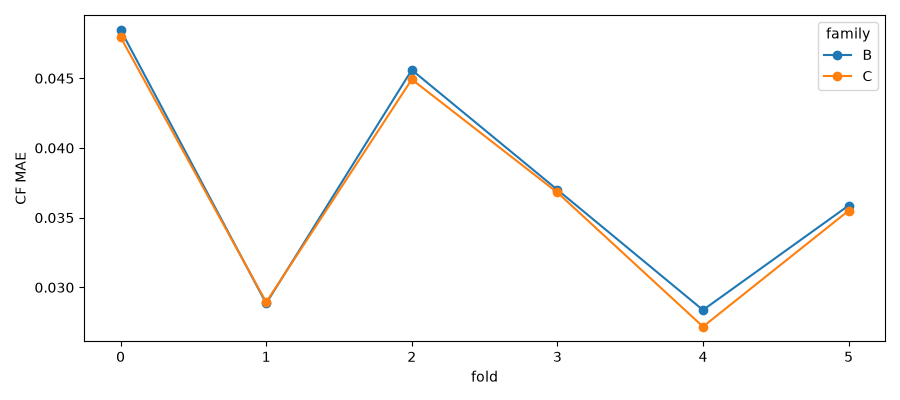
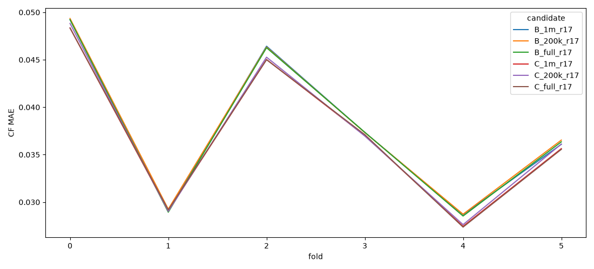
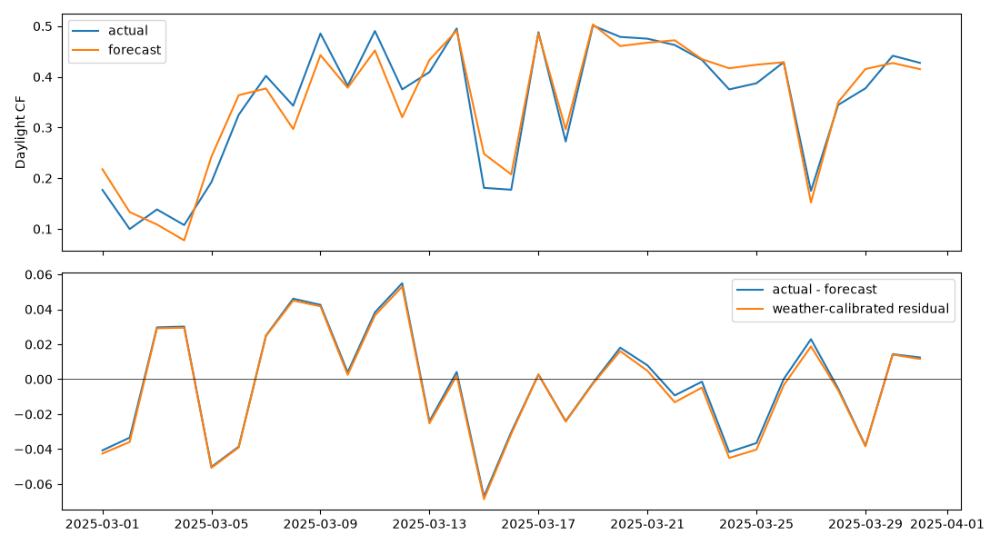

# OIBC 2026 3차 실험

원본/외부 데이터 정책: 제공 파일만 읽고 실측 기상·외부 산불 기록·사전학습 모델을 사용하지 않았습니다. raw SHA256을 전후 대조했습니다.

## 검증 경계와 가용 시각

운영일 D는 (D 00:00, D+1 00:00]입니다. 기존 코드의 실제 비교는 `ts > start` / `ts <= end`이므로 3월1일00시는 봄 fold에 포함되지 않았습니다. 기존 start는 배타 경계였으며 이번에는 운영일과 실제 첫/마지막 샘플을 명시합니다. 운영일 기반 재선택과 기존 샘플이 전수 일치하여 경계 수정에 의한 성능 차이는 0입니다. boundary_audit.csv, boundary_metric_comparison.csv와 provenance/fold*.parquet에 각 샘플 발행·학습 종료·예보10/17 발행·lag/rolling 원천 시각을 저장했습니다. 모든 원천 시각은 발행 시각 이하입니다. 실제 발전실적 수신 지연은 제공 파일에 없으므로 즉시 수신 가정은 여전히 조건입니다. 평가용 test 폴더에는 예보만 있고 기간 중 실적이 제공되지 않습니다. 따라서 C의 rolling 성능은 해당 기간에도 과거 실적을 수신할 수 있는 경우에 한하며, 별도 실적 제공이 확인되기 전에는 오프라인 제출 가능 성능으로 간주할 수 없습니다. B는 제공 예보와 정적/시간 피처로 계산 가능합니다. 정적 메타가 과거에도 유효했다는 가정도 남습니다.

## 선택 절차와 holdout 한계

최종 holdout용 튜닝은 fold0~3의 200k CF MAE 평균으로 세 가지 고정 grid를 비교합니다. 과거 fold는 첫 발행 전에 끝난 튜닝 fold만 사용해 별도로 설정을 고릅니다. fold0은 사전 고정 grid0, fold1은 튜닝fold0, fold2/3은 튜닝fold0~1, fold4는 튜닝fold0~2, fold5는 튜닝fold0~3을 사용합니다. 직전 fold의 마지막00시가 첫 발행 이후인 경우 해당 튜닝 구간 전체를 제외했습니다. parameter_schedule.json과 예측의 parameter_source_max에 근거를 저장합니다. 트리 수·learning rate·num_leaves·min_data_in_leaf를 함께 바꾸는 제한된 탐색입니다. 코드의 min_child_samples는 min_data_in_leaf의 sklearn API 별칭입니다. 튜닝에 완전한 fleet 정답 시간이 없어 CF MAE를 대리 지표로 사용했습니다. 이후 학습량·예보라운드·후처리는 fold0~4 중 완전 fleet의 공식 정산 페널티로 선택하며, 해당 시간은 fold4에만 있습니다. 최종 봄 fold5는 튜닝/선택/그룹최적화에서 제외하고, 직전 개발fold4의 마지막7시간(2월28일18시~3월1일00시)도 첫 발행 시각 이후이므로 선택·그룹최적화·3월 잔차 보정 학습에서 제외했습니다. scores_selection.csv가 이 embargo를 적용한 선택용 점수이고 scores_development.csv는 전체 개발기간 기술 점수입니다. 또한 selection_lock.json 및 composition_lock.json을 먼저 저장한 뒤 평가했습니다. 단, 봄 구간은 2차 보고서에서 이미 확인한 자료이므로 완전히 새로 봉인된 미관측 holdout은 아닙니다. 이 한계는 이번 절차로 소급 제거할 수 없습니다. fold4도 선택에 사용했으므로 그 성능은 최종 독립 성능이 아닙니다.

## 학습량·예보·야간 후처리

B/C 각각 200k·1m·전체 학습과 r17·r10·r10+r17·두 라운드+수정량을 비교했습니다. 라운드 비교는 동일한 최대100만 학습 행에서 수행했습니다. 학습량 효과는 r17을 고정한200k/1m/full 비교로 분리했습니다. 같은 fold의 모델들은 같은 정답 마스크·동일 family별 튜닝 설정을 사용합니다. fold별 파라미터는 엄격한 과거 가용성 때문에 다를 수 있습니다. 200k/1m는 이전 실험과 같은 시간순 등간격 표본이며 이상치는 이후 제외합니다. sample_*.csv는 발전소×계절(0=겨울,1=봄,2=여름,3=가을)별 표본 수입니다. 전체행 모델도 각 fold 이전 정답만 사용합니다. 1m는 최대100만 행이며 첫 fold는 과거 유효 데이터가 약96만 행뿐이므로 전체행과 같습니다. 부족한 행을 복제하거나 이후 자료로 채우지 않았습니다. feature importance gain/splits와 변수별 학습/검증 결측률을 저장했습니다. missing_weather별 오차는 관측 분포의 차이를 포함하는 기술 통계이며 결측의 인과효과는 아닙니다. 예보 결측은 native missing branch로 처리했습니다.

raw는 기존과 같은 음수 예측 하한 0입니다. night_only는 시간구간 시작·중앙·끝의 최대 태양고도가 -6도 이하일 때만 0으로 합니다. train_calibrated는 발전소별 학습 관측168시간 이상이며 최대 CF<=.001인 고도 임계값(-12/-9/-6/-3/0)을 찾습니다. 불충분한 발전소는 -6도 fallback입니다. 학습 구간만 사용하고 검증 정답으로 조건을 맞추지 않습니다. 야간 최대고도 검사는 일출·일몰 한 시간 구간에 일부 햇빛이 있는 경우를 보수적으로 보존합니다. metrics의 twilight와 removed_actual_kwh는 실제 발전량 제거량을 보여줍니다. 집합 야간/주간 페널티는 별도 고정 시계시간(07~18시/나머지)이며 발전소별 고도 분류와 구분합니다.

## 사전 선택된 후보

전역 추천도 개발 선택용 페널티만 비교해 결정했습니다. 봄 정답으로 B/C 중 하나를 고르지 않았습니다.

```json
{
  "preferred": {
    "family": "B",
    "candidate": "B_1m_revision",
    "policy": "train_calibrated",
    "criterion": "sum complete-fleet development penalty (fold4 only)",
    "development_penalty_krw": 29826045.783934884
  },
  "holdout_used": false,
  "source": "scores_selection.csv",
  "selection_source_max": "2025-02-28 17:00:00+09:00",
  "selection_lock_sha256": "c64418961e6cf6b83be06e4df53f234245b6bda55a4c3994425cbb6f74c84476"
}
```

```json
{
  "B": {
    "candidate": "B_1m_revision",
    "policy": "train_calibrated",
    "criterion": "sum complete-fleet development penalty (fold4 only)"
  },
  "C": {
    "candidate": "C_1m_r17",
    "policy": "train_calibrated",
    "criterion": "sum complete-fleet development penalty (fold4 only)"
  }
}
```

| index | family | fold | candidate | policy | cf_mae | mae_kwh |
| --- | --- | --- | --- | --- | --- | --- |
| 18569 | B | 0 | B_1m_revision | train_calibrated | 0.0484752 | 4.4616 |
| 19136 | B | 1 | B_1m_revision | train_calibrated | 0.0288463 | 4.51327 |
| 19916 | B | 2 | B_1m_revision | train_calibrated | 0.0455971 | 7.21129 |
| 20774 | B | 3 | B_1m_revision | train_calibrated | 0.0370015 | 5.96361 |
| 21634 | B | 4 | B_1m_revision | train_calibrated | 0.0283728 | 4.92469 |
| 4879 | B | 5 | B_1m_revision | train_calibrated | 0.0358699 | 6.25602 |
| 25877 | C | 0 | C_1m_r17 | train_calibrated | 0.0479569 | 4.43596 |
| 26444 | C | 1 | C_1m_r17 | train_calibrated | 0.0289352 | 4.50596 |
| 27224 | C | 2 | C_1m_r17 | train_calibrated | 0.0449212 | 7.13436 |
| 28082 | C | 3 | C_1m_r17 | train_calibrated | 0.0368061 | 5.94114 |
| 28942 | C | 4 | C_1m_r17 | train_calibrated | 0.0271805 | 4.6115 |
| 6601 | C | 5 | C_1m_r17 | train_calibrated | 0.0355016 | 6.0925 |

## 공식 정산 결과 (각 fold 안에서만 비교)

| candidate | policy | fold | composition | group | scored_hours | mae_kwh | penalty_krw | score_krw | score_available | family |
| --- | --- | --- | --- | --- | --- | --- | --- | --- | --- | --- |
| B_1m_revision | train_calibrated | 0 | balanced | total | 0 | nan | nan | nan | False | B |
| B_1m_revision | train_calibrated | 0 | optimized | total | 0 | nan | nan | nan | False | B |
| B_1m_revision | train_calibrated | 1 | balanced | total | 0 | nan | nan | nan | False | B |
| B_1m_revision | train_calibrated | 1 | optimized | total | 0 | nan | nan | nan | False | B |
| B_1m_revision | train_calibrated | 2 | balanced | total | 0 | nan | nan | nan | False | B |
| B_1m_revision | train_calibrated | 2 | optimized | total | 0 | nan | nan | nan | False | B |
| B_1m_revision | train_calibrated | 3 | balanced | total | 0 | nan | nan | nan | False | B |
| B_1m_revision | train_calibrated | 3 | optimized | total | 0 | nan | nan | nan | False | B |
| B_1m_revision | train_calibrated | 4 | balanced | total | 1594 | 313.676 | 2.98329e+07 | 1.14549e+09 | True | B |
| B_1m_revision | train_calibrated | 4 | optimized | total | 1594 | 307.289 | 2.92208e+07 | 1.1461e+09 | True | B |
| B_1m_revision | train_calibrated | 5 | balanced | total | 2208 | 433.258 | 5.08969e+07 | 2.1572e+09 | True | B |
| B_1m_revision | train_calibrated | 5 | optimized | total | 2208 | 431.156 | 5.0844e+07 | 2.15725e+09 | True | B |
| C_1m_r17 | train_calibrated | 0 | balanced | total | 0 | nan | nan | nan | False | C |
| C_1m_r17 | train_calibrated | 0 | optimized | total | 0 | nan | nan | nan | False | C |
| C_1m_r17 | train_calibrated | 1 | balanced | total | 0 | nan | nan | nan | False | C |
| C_1m_r17 | train_calibrated | 1 | optimized | total | 0 | nan | nan | nan | False | C |
| C_1m_r17 | train_calibrated | 2 | balanced | total | 0 | nan | nan | nan | False | C |
| C_1m_r17 | train_calibrated | 2 | optimized | total | 0 | nan | nan | nan | False | C |
| C_1m_r17 | train_calibrated | 3 | balanced | total | 0 | nan | nan | nan | False | C |
| C_1m_r17 | train_calibrated | 3 | optimized | total | 0 | nan | nan | nan | False | C |
| C_1m_r17 | train_calibrated | 4 | balanced | total | 1594 | 323.245 | 3.0706e+07 | 1.14462e+09 | True | C |
| C_1m_r17 | train_calibrated | 4 | optimized | total | 1594 | 319.128 | 3.03412e+07 | 1.14498e+09 | True | C |
| C_1m_r17 | train_calibrated | 5 | balanced | total | 2208 | 438.812 | 5.12684e+07 | 2.15683e+09 | True | C |
| C_1m_r17 | train_calibrated | 5 | optimized | total | 2208 | 437.047 | 5.12113e+07 | 2.15688e+09 | True | C |

공식 산식은 README의 S=ΣSMP·실적−0.1ΣSMP·k·|오차|, k=11~15시3/기타1입니다. 그룹 구성은253개소를 정확히 G1/G2로 분할하며 각20,000kW 이상입니다. 원본 정답253개소가 모두 있는 시간만 집합 채점합니다. 없는 정답을 0으로 채우지 않습니다. scores_*.csv에서 score_available=False 및 NaN인 fold는 점수를 계산할 수 없습니다. fold마다 평가 시간이 달라 총 정산금을 fold 사이에 단순 비교하지 않습니다.

## OOF 그룹 최적화

OOF_B/C.parquet은 fold0~4 중 최종 holdout 첫 발행 시각(2025-02-28 17시)까지의 관측만 포함합니다. 모든 예측은 해당 운영일 발행 전 자료로 학습했고, C는 일별로 수신된 과거 실적을 갱신하는 rolling-origin입니다. 그룹 선택은 이 학습 OOF 중 253개소 완전 관측인 fold4 시간만 사용합니다. 초기 용량 균형 배정에서 고정seed 단일 이동/쌍 교환5000회로 페널티를 낮춥니다. 전역 최적을 보장하지 않습니다. 잔차 상관·공통 관측 수·상반 부호 비율은 pairwise 공통 시각만 사용하고 NaN을0으로 채우지 않습니다. 상반부호 비율의 0은 실제 잔차 부호가0인 경우도 포함합니다. optimization_development.csv에 개별 오차합 대비 상쇄율과 그룹 용량을 저장했습니다. Holdout 그룹 성능은 selected_composition_metrics.csv에 독립적으로 평가했습니다. 다른 family의 예측에 대해 최적화한 그룹을 섞어 선택하지 않았습니다.

## 2025년3월 잔차와 산불 가설

V3_B 계열의 사전 선택 모델 raw 예측(actual−forecast)을 분석했습니다. 이 모델 자체가 기상예보·시간·발전소 메타를 조건으로 예측합니다. 추가로 이전 OOF 잔차에 Ridge를 학습해 기상·태양고도·예측 CF에 따른 체계적 편향을 보정했습니다. 3월 정답은 보정 모델 학습에 사용하지 않았습니다. march_daily_cf_residual.csv에 주간CF·원잔차·조건부 잔차·과거 일평균 대비 경험적 하위꼬리 p 및 BH 보정값을 저장했습니다. 이는 계절/공간/시간상관 및 OOF 보정의 훈련내 편향을 완전히 통제하지 못하는 탐색치입니다. 통계적 인과 검정으로 해석하지 않습니다. 과거 날짜 분포가 봄과 교환가능하다는 보장도 없습니다.

지역 패턴은 제공된 익명 WA지점 및 비식별 좌표의4×4분위수 격자로만 집계합니다. 실제 지역·설비·사업자를 추정하지 않습니다. 특정 날 음의 잔차 또는 지역 동시 감소가 있어도 원인은 계측·예보오차·운영·미관측 기상 등과 구분되지 않습니다. 2025년 월평균 하락은 산불 증거가 아닙니다. 외부 산불 데이터는 사용하지 않았습니다.

## 상세 결과와 재현

- metrics_development/holdout.csv: 모든 실험의 발전소·시간대·월·주야간·신규/기존·기상결측별 CF MAE/kWh MAE, 제거량.
- scores_development/holdout.csv: 각 실험/후처리의 G1/G2 및 전체 MAE, 공식 페널티/정산금, 유효 시간 수.
- settlement_periods_*.csv: 시계시간 기준 집합 주야간 MAE/페널티/정산금.
- improvement_vs_stage2.csv: 같은 fold 원본 V3_B/C 대비 CF MAE 차이.
- models/, predictions/, checkpoints/: 모든 모델·원본 예측·설정 fingerprint. feature_spec.json은 원본+이전 피처 파일 해시를 고정합니다.
- selected_B/C_holdout.parquet: 사전 선택된 모델/후처리 holdout 예측. OOF_B/C는 그룹 최적화용이며 holdout을 포함하지 않습니다.

이 결과는 세 grid의 제한된 튜닝과 겨울 OOF만으로 그룹을 선택한 결과입니다. 다음 우선순위는 새로운 미관측 기간 평가, 발전 실적 수신지연 확인, 더 긴 완전fleet OOF 축적과 그룹배정 안정성 확인입니다.







## 기존 대비 개선 및 학습량 비교

| index | fold | family | cf_mae | old_cf_mae | delta |
| --- | --- | --- | --- | --- | --- |
| 17 | 0 | B | 0.0484752 | 0.0493473 | -0.000872099 |
| 35 | 1 | B | 0.0288463 | 0.0311825 | -0.00233616 |
| 53 | 2 | B | 0.0455971 | 0.0475152 | -0.00191803 |
| 71 | 3 | B | 0.0370015 | 0.0387319 | -0.00173036 |
| 89 | 4 | B | 0.0283728 | 0.0308278 | -0.00245496 |
| 107 | 5 | B | 0.0358699 | 0.0386892 | -0.00281925 |
| 113 | 0 | C | 0.0479569 | 0.0488313 | -0.000874336 |
| 131 | 1 | C | 0.0289352 | 0.0309875 | -0.00205226 |
| 149 | 2 | C | 0.0449212 | 0.0465716 | -0.00165041 |
| 167 | 3 | C | 0.0368061 | 0.0383268 | -0.00152061 |
| 185 | 4 | C | 0.0271805 | 0.029296 | -0.00211551 |
| 203 | 5 | C | 0.0355016 | 0.038004 | -0.00250247 |

6개 fold 평균은 사후 기술 요약이며 모델 선택에는 사용하지 않았습니다.

| candidate | macro_6fold_cf_mae |
| --- | --- |
| B_1m_both | 0.0376669 |
| B_1m_r10 | 0.0386787 |
| B_1m_r17 | 0.0378041 |
| B_1m_revision | 0.0376237 |
| B_200k_r17 | 0.0379218 |
| B_full_r17 | 0.0377789 |
| C_1m_both | 0.0369984 |
| C_1m_r10 | 0.0379819 |
| C_1m_r17 | 0.0370941 |
| C_1m_revision | 0.0369184 |
| C_200k_r17 | 0.0373058 |
| C_full_r17 | 0.0370938 |
## 선택 후보의 야간 후처리별 공식 페널티

| index | fold | candidate | policy | scored_hours | penalty_krw | score_krw |
| --- | --- | --- | --- | --- | --- | --- |
| 227 | 0 | B_1m_revision | raw | 0 | nan | nan |
| 230 | 0 | B_1m_revision | night_only | 0 | nan | nan |
| 233 | 0 | B_1m_revision | train_calibrated | 0 | nan | nan |
| 236 | 1 | B_1m_revision | raw | 0 | nan | nan |
| 239 | 1 | B_1m_revision | night_only | 0 | nan | nan |
| 242 | 1 | B_1m_revision | train_calibrated | 0 | nan | nan |
| 245 | 2 | B_1m_revision | raw | 0 | nan | nan |
| 248 | 2 | B_1m_revision | night_only | 0 | nan | nan |
| 251 | 2 | B_1m_revision | train_calibrated | 0 | nan | nan |
| 254 | 3 | B_1m_revision | raw | 0 | nan | nan |
| 257 | 3 | B_1m_revision | night_only | 0 | nan | nan |
| 260 | 3 | B_1m_revision | train_calibrated | 0 | nan | nan |
| 263 | 4 | B_1m_revision | raw | 1594 | 2.99989e+07 | 1.14532e+09 |
| 266 | 4 | B_1m_revision | night_only | 1594 | 2.98373e+07 | 1.14548e+09 |
| 269 | 4 | B_1m_revision | train_calibrated | 1594 | 2.98329e+07 | 1.14549e+09 |
| 47 | 5 | B_1m_revision | raw | 2208 | 5.10404e+07 | 2.15705e+09 |
| 50 | 5 | B_1m_revision | night_only | 2208 | 5.09016e+07 | 2.15719e+09 |
| 53 | 5 | B_1m_revision | train_calibrated | 2208 | 5.08969e+07 | 2.1572e+09 |
| 317 | 0 | C_1m_r17 | raw | 0 | nan | nan |
| 320 | 0 | C_1m_r17 | night_only | 0 | nan | nan |
| 323 | 0 | C_1m_r17 | train_calibrated | 0 | nan | nan |
| 326 | 1 | C_1m_r17 | raw | 0 | nan | nan |
| 329 | 1 | C_1m_r17 | night_only | 0 | nan | nan |
| 332 | 1 | C_1m_r17 | train_calibrated | 0 | nan | nan |
| 335 | 2 | C_1m_r17 | raw | 0 | nan | nan |
| 338 | 2 | C_1m_r17 | night_only | 0 | nan | nan |
| 341 | 2 | C_1m_r17 | train_calibrated | 0 | nan | nan |
| 344 | 3 | C_1m_r17 | raw | 0 | nan | nan |
| 347 | 3 | C_1m_r17 | night_only | 0 | nan | nan |
| 350 | 3 | C_1m_r17 | train_calibrated | 0 | nan | nan |
| 353 | 4 | C_1m_r17 | raw | 1594 | 3.0837e+07 | 1.14448e+09 |
| 356 | 4 | C_1m_r17 | night_only | 1594 | 3.07113e+07 | 1.14461e+09 |
| 359 | 4 | C_1m_r17 | train_calibrated | 1594 | 3.0706e+07 | 1.14462e+09 |
| 65 | 5 | C_1m_r17 | raw | 2208 | 5.1382e+07 | 2.15671e+09 |
| 68 | 5 | C_1m_r17 | night_only | 2208 | 5.12721e+07 | 2.15682e+09 |
| 71 | 5 | C_1m_r17 | train_calibrated | 2208 | 5.12684e+07 | 2.15683e+09 |
## 일출·일몰 인접 구간 영향

| index | fold | candidate | policy | rows | cf_mae | removed_actual_kwh | removed_prediction_kwh |
| --- | --- | --- | --- | --- | --- | --- | --- |
| 18411 | 0 | B_1m_revision | raw | 22607 | 0.0017984 | 0 | 0 |
| 18562 | 0 | B_1m_revision | night_only | 22607 | 0.0017984 | 0 | 0 |
| 18713 | 0 | B_1m_revision | train_calibrated | 22607 | 0.00158153 | 5.2 | 369.103 |
| 18920 | 1 | B_1m_revision | raw | 30888 | 0.00335568 | 0 | 0 |
| 19128 | 1 | B_1m_revision | night_only | 30888 | 0.00335568 | 0 | 0 |
| 19336 | 1 | B_1m_revision | train_calibrated | 30888 | 0.0031931 | 37.0403 | 1285.84 |
| 19623 | 2 | B_1m_revision | raw | 47093 | 0.00142334 | 0 | 0 |
| 19909 | 2 | B_1m_revision | night_only | 47093 | 0.00142334 | 0 | 0 |
| 20195 | 2 | B_1m_revision | train_calibrated | 47093 | 0.0013725 | 20.538 | 389.847 |
| 20481 | 3 | B_1m_revision | raw | 46688 | 0.00189453 | 0 | 0 |
| 20767 | 3 | B_1m_revision | night_only | 46688 | 0.00189453 | 0 | 0 |
| 21053 | 3 | B_1m_revision | train_calibrated | 46688 | 0.0018269 | 23.1909 | 509.849 |
| 21340 | 4 | B_1m_revision | raw | 50514 | 0.00308356 | 0 | 0 |
| 21627 | 4 | B_1m_revision | night_only | 50514 | 0.00308356 | 0 | 0 |
| 21914 | 4 | B_1m_revision | train_calibrated | 50514 | 0.0029691 | 29.2862 | 978.215 |
| 4585 | 5 | B_1m_revision | raw | 48788 | 0.00180735 | 0 | 0 |
| 4872 | 5 | B_1m_revision | night_only | 48788 | 0.00180735 | 0 | 0 |
| 5159 | 5 | B_1m_revision | train_calibrated | 48788 | 0.00174591 | 22.3253 | 610.159 |
| 25719 | 0 | C_1m_r17 | raw | 22607 | 0.00170233 | 0 | 0 |
| 25870 | 0 | C_1m_r17 | night_only | 22607 | 0.00170233 | 0 | 0 |
| 26021 | 0 | C_1m_r17 | train_calibrated | 22607 | 0.0015034 | 5.3 | 336.468 |
| 26228 | 1 | C_1m_r17 | raw | 30888 | 0.00294678 | 0 | 0 |
| 26436 | 1 | C_1m_r17 | night_only | 30888 | 0.00294678 | 0 | 0 |
| 26644 | 1 | C_1m_r17 | train_calibrated | 30888 | 0.00285556 | 38.1139 | 643.042 |
| 26931 | 2 | C_1m_r17 | raw | 47093 | 0.0012346 | 0 | 0 |
| 27217 | 2 | C_1m_r17 | night_only | 47093 | 0.0012346 | 0 | 0 |
| 27503 | 2 | C_1m_r17 | train_calibrated | 47093 | 0.00120226 | 21.1172 | 282.234 |
| 27789 | 3 | C_1m_r17 | raw | 46688 | 0.00158508 | 0 | 0 |
| 28075 | 3 | C_1m_r17 | night_only | 46688 | 0.00158508 | 0 | 0 |
| 28361 | 3 | C_1m_r17 | train_calibrated | 46688 | 0.00152007 | 26.7266 | 536.463 |
| 28648 | 4 | C_1m_r17 | raw | 50514 | 0.002645 | 0 | 0 |
| 28935 | 4 | C_1m_r17 | night_only | 50514 | 0.002645 | 0 | 0 |
| 29222 | 4 | C_1m_r17 | train_calibrated | 50514 | 0.00255666 | 33.154 | 834.085 |
| 6307 | 5 | C_1m_r17 | raw | 48788 | 0.00152694 | 0 | 0 |
| 6594 | 5 | C_1m_r17 | night_only | 48788 | 0.00152694 | 0 | 0 |
| 6881 | 5 | C_1m_r17 | train_calibrated | 48788 | 0.00148066 | 21.9877 | 473.646 |
## 3월 조건부 음의 잔차 연속 구간 (탐색)

| start | end | days | mean_conditional_residual_cf |
| --- | --- | --- | --- |
| 2025-03-01 00:00:00+09:00 | 2025-03-02 00:00:00+09:00 | 2 | -0.0392359 |
| 2025-03-05 00:00:00+09:00 | 2025-03-06 00:00:00+09:00 | 2 | -0.0448831 |
| 2025-03-13 00:00:00+09:00 | 2025-03-13 00:00:00+09:00 | 1 | -0.0252452 |
| 2025-03-15 00:00:00+09:00 | 2025-03-16 00:00:00+09:00 | 2 | -0.0500173 |
| 2025-03-18 00:00:00+09:00 | 2025-03-19 00:00:00+09:00 | 2 | -0.0134389 |
| 2025-03-22 00:00:00+09:00 | 2025-03-26 00:00:00+09:00 | 5 | -0.0213638 |
| 2025-03-28 00:00:00+09:00 | 2025-03-29 00:00:00+09:00 | 2 | -0.0223779 |

이전 V3_B와 개선 B의 동일 주간 관측 잔차 비교도 march_stage2_stage3_residual_comparison.csv에 저장했습니다. 음의 잔차 날짜는 모델 설정에 따라 달라질 수 있습니다.


음의 조건부 잔차가 큰 날짜: 

| index | day | actual_cf | pred_cf | residual_cf | conditional_residual_cf | empirical_lower_tail_p | BH_q |
| --- | --- | --- | --- | --- | --- | --- | --- |
| 14 | 2025-03-15 00:00:00+09:00 | 0.181057 | 0.248191 | -0.0671339 | -0.0686352 | 0.0743982 | 0.678337 |
| 4 | 2025-03-05 00:00:00+09:00 | 0.19244 | 0.242626 | -0.0501859 | -0.050701 | 0.118162 | 0.678337 |
| 23 | 2025-03-24 00:00:00+09:00 | 0.375161 | 0.416819 | -0.0416586 | -0.0450832 | 0.140044 | 0.678337 |
| 0 | 2025-03-01 00:00:00+09:00 | 0.177045 | 0.217756 | -0.040711 | -0.0425417 | 0.150985 | 0.678337 |
| 24 | 2025-03-25 00:00:00+09:00 | 0.387289 | 0.423839 | -0.0365498 | -0.0402758 | 0.157549 | 0.678337 |
| 5 | 2025-03-06 00:00:00+09:00 | 0.325142 | 0.36375 | -0.038608 | -0.0390652 | 0.159737 | 0.678337 |
| 28 | 2025-03-29 00:00:00+09:00 | 0.377286 | 0.415397 | -0.0381115 | -0.0383811 | 0.164114 | 0.678337 |

익명 격자에서 같은 날 음의 잔차가 나타난 비율: 

| day | regions | negative_regions | mean_residual | negative_region_fraction |
| --- | --- | --- | --- | --- |
| 2025-03-15 00:00:00+09:00 | 15 | 12 | -0.0695538 | 0.8 |
| 2025-03-01 00:00:00+09:00 | 15 | 15 | -0.0479273 | 1 |
| 2025-03-25 00:00:00+09:00 | 15 | 15 | -0.0456421 | 1 |
| 2025-03-24 00:00:00+09:00 | 15 | 13 | -0.0453409 | 0.866667 |
| 2025-03-29 00:00:00+09:00 | 15 | 15 | -0.0433077 | 1 |
| 2025-03-05 00:00:00+09:00 | 15 | 13 | -0.0428049 | 0.866667 |
| 2025-03-06 00:00:00+09:00 | 15 | 10 | -0.035342 | 0.666667 |

위 날짜나 동시성은 이상 패턴 후보이며 산불 발생일·피해지역의 추정 또는 원인 확정이 아닙니다. 예보 오차와 관측되지 않은 기상/운영 변화가 남아 있습니다.

## 발전소·계절별 표본 분포

| fold | scale | fit_rows | full_eligible_rows | sites | missing_site_season_cells | site_season_total_variation |
| --- | --- | --- | --- | --- | --- | --- |
| 0 | 200k | 199989 | 964536 | 106 | 0 | 0.00612113 |
| 0 | 1m | 964536 | 964536 | 106 | 0 | 0 |
| 0 | full | 964536 | 964536 | 106 | 0 | 0 |
| 1 | 200k | 199993 | 1486853 | 136 | 0 | 0.0126398 |
| 1 | 1m | 999964 | 1486853 | 136 | 0 | 0.00237903 |
| 1 | full | 1486853 | 1486853 | 136 | 0 | 0 |
| 2 | 200k | 199997 | 2220438 | 205 | 2 | 0.0142306 |
| 2 | 1m | 999983 | 2220438 | 205 | 0 | 0.00596449 |
| 2 | full | 2220438 | 2220438 | 205 | 0 | 0 |
| 3 | 200k | 199998 | 2735848 | 252 | 0 | 0.0148174 |
| 3 | 1m | 999975 | 2735848 | 252 | 0 | 0.00394749 |
| 3 | full | 2735848 | 2735848 | 252 | 0 | 0 |
| 4 | 200k | 200000 | 3286216 | 252 | 0 | 0.0116667 |
| 4 | 1m | 999977 | 3286216 | 252 | 0 | 0.00361963 |
| 4 | full | 3286216 | 3286216 | 252 | 0 | 0 |
| 5 | 200k | 199998 | 3832123 | 253 | 0 | 0.0154016 |
| 5 | 1m | 999985 | 3832123 | 253 | 0 | 0.00453952 |
| 5 | full | 3832123 | 3832123 | 253 | 0 | 0 |

selected share와 full share의 total variation은0이면 같은 분포입니다. B/C 표본 인덱스는 같으며 분포는 B 파일로 대표했습니다. 세부 발전소×계절 수는 sample_distribution.csv에 있습니다.

## B 선택 모델의 기상 중요도 및 결측

| index | feature | gain | splits | train_missing_rate | validation_missing_rate | family | gain_share |
| --- | --- | --- | --- | --- | --- | --- | --- |
| 19 | wa_humidity | 69148.7 | 331 | 0.000560008 | 0 | B | 0.105902 |
| 35 | wb_uv_idx | 18450.6 | 155 | 0.000885013 | 0 | B | 0.0282572 |
| 15 | wa_cloud | 8596.12 | 442 | 0.000560008 | 0 | B | 0.013165 |
| 32 | wb_rel_hum | 7380.54 | 173 | 0.000885013 | 0 | B | 0.0113034 |
| 46 | wa_cloud_r10 | 5392.61 | 317 | 0.000802012 | 0 | B | 0.00825882 |
| 50 | wa_humidity_r10 | 3572.63 | 104 | 0.000802012 | 0 | B | 0.0054715 |
| 36 | wb_precip_prob | 1550.62 | 124 | 0.00102902 | 0 | B | 0.00237478 |
| 59 | wb_dew_point_r10 | 1336.44 | 145 | 0.00230603 | 0 | B | 0.00204676 |
| 16 | wa_temp | 1148.94 | 173 | 0.000560008 | 0 | B | 0.00175961 |
| 63 | wb_rel_hum_r10 | 1148.43 | 124 | 0.00230603 | 0 | B | 0.00175883 |
| 28 | wb_dew_point | 1034.4 | 142 | 0.000885013 | 0 | B | 0.00158419 |
| 66 | wb_uv_idx_r10 | 977.278 | 64 | 0.00230603 | 0 | B | 0.00149671 |
| 47 | wa_temp_r10 | 851.859 | 138 | 0.000802012 | 0 | B | 0.00130463 |
| 23 | wa_rain | 814.555 | 113 | 0.000560008 | 0 | B | 0.0012475 |
| 44 | wb_cloud | 647.591 | 163 | 0.000885013 | 0 | B | 0.00099179 |
## C 선택 모델의 기상 중요도 및 결측

| index | feature | gain | splits | train_missing_rate | validation_missing_rate | family | gain_share |
| --- | --- | --- | --- | --- | --- | --- | --- |
| 19 | wa_humidity | 70847.4 | 402 | 0.000560008 | 0 | C | 0.108111 |
| 35 | wb_uv_idx | 18919.7 | 209 | 0.000885013 | 0 | C | 0.0288709 |
| 15 | wa_cloud | 13077.9 | 737 | 0.000560008 | 0 | C | 0.0199565 |
| 32 | wb_rel_hum | 9755.48 | 297 | 0.000885013 | 0 | C | 0.0148866 |
| 36 | wb_precip_prob | 2353.96 | 185 | 0.00102902 | 0 | C | 0.00359207 |
| 28 | wb_dew_point | 2343.34 | 282 | 0.000885013 | 0 | C | 0.00357587 |
| 16 | wa_temp | 1744.23 | 277 | 0.000560008 | 0 | C | 0.00266165 |
| 26 | wb_feel_temp | 1202.16 | 189 | 0.000885013 | 0 | C | 0.00183447 |
| 23 | wa_rain | 1128.21 | 165 | 0.000560008 | 0 | C | 0.00172162 |
| 34 | wb_ceiling | 1034.14 | 324 | 0.000885013 | 0 | C | 0.00157806 |
| 20 | wa_ground_press | 961.751 | 427 | 0.000560008 | 0 | C | 0.0014676 |
| 22 | wa_wind_dir | 911.981 | 301 | 0.000560008 | 0 | C | 0.00139166 |
| 44 | wb_cloud | 885.185 | 260 | 0.000885013 | 0 | C | 0.00135077 |
| 25 | wb_temp | 789.138 | 116 | 0.000885013 | 0 | C | 0.0012042 |
| 21 | wa_wind_speed | 460.898 | 247 | 0.000560008 | 0 | C | 0.000703317 |

Gain은 상관된 예보 변수들 사이에서 분산되며 인과효과나 유일한 중요도를 뜻하지 않습니다. 검증 결측과 오차의 관계는 metrics의 missing_weather 행을 확인하십시오.

## 평가 기간 중 실적을 받지 못하는 C 민감도

각 fold 첫 발행 시점 이후 실적을 전혀 받지 않는 경우를 별도 재추론했습니다. 모델/하이퍼파라미터/후처리/그룹은 다시 선택하지 않았습니다. 관측되지 않은 lag는 NaN, 빈7일 구간의 평균은 NaN/관측수0입니다. 실적을0으로 채운 것이 아닙니다. 이 결과는 test 파일에 실적 스트림이 없는 조건에서 C 성능을 해석하기 위한 보조 실험입니다.

| index | fold | policy | cf_mae | mae_kwh |
| --- | --- | --- | --- | --- |
| 302 | 0 | train_calibrated | 0.0539689 | 4.93956 |
| 869 | 1 | train_calibrated | 0.0305253 | 4.67226 |
| 1649 | 2 | train_calibrated | 0.0492731 | 7.77292 |
| 2507 | 3 | train_calibrated | 0.0387214 | 6.20287 |
| 3367 | 4 | train_calibrated | 0.0302928 | 5.15558 |
| 4228 | 5 | train_calibrated | 0.0400508 | 6.84135 |

세부 주야간·신규/기존·정산 점수는 offline_C_metrics.csv와 offline_C_scores.csv에 저장했습니다. 이 민감도나 봄 점수로 사전 추천을 바꾸지 않았습니다.

## 그룹 상쇄 및 오차 하한

| family | composition | training_oof_hours | penalty_krw | fleet_error_lower_bound_krw | gap_to_bound_krw |
| --- | --- | --- | --- | --- | --- |
| B | balanced | 1587 | 2.9826e+07 | 2.90257e+07 | 800366 |
| B | optimized | 1587 | 2.9214e+07 | 2.90257e+07 | 188328 |
| C | balanced | 1587 | 3.07016e+07 | 3.02407e+07 | 460840 |
| C | optimized | 1587 | 3.03368e+07 | 3.02407e+07 | 96045 |

fleet 오차 하한은 같은 시각 전체 발전소 잔차 합의 절대값으로, 어떤2개 그룹으로 나누어도 이보다 페널티를 낮출 수 없습니다. 용량 제약 아래에서 달성 가능함을 보장하지 않습니다. 최적화 잔여 여지를 판단하는 하한입니다.

## 데이터 누수 경계 표

| fold | operating_start | operating_end_exclusive | actual_first | actual_last | model_training_cutoff | training_actual_max | first_issue | last_issue | validation_rows | changed_rows | future_source_violations |
| --- | --- | --- | --- | --- | --- | --- | --- | --- | --- | --- | --- |
| 0 | 2023-06-01 | 2023-09-01 | 2023-06-01 01:00:00+09:00 | 2023-09-01 00:00:00+09:00 | 2023-05-31 17:00:00+09:00 | 2023-05-31 17:00:00+09:00 | 2023-05-31 17:00:00+09:00 | 2023-08-30 17:00:00+09:00 | 246641 | 0 | 0 |
| 1 | 2023-12-01 | 2024-03-01 | 2023-12-01 01:00:00+09:00 | 2024-03-01 00:00:00+09:00 | 2023-11-30 17:00:00+09:00 | 2023-11-30 17:00:00+09:00 | 2023-11-30 17:00:00+09:00 | 2024-02-28 17:00:00+09:00 | 335139 | 0 | 0 |
| 2 | 2024-06-01 | 2024-09-01 | 2024-06-01 01:00:00+09:00 | 2024-09-01 00:00:00+09:00 | 2024-05-31 17:00:00+09:00 | 2024-05-31 17:00:00+09:00 | 2024-05-31 17:00:00+09:00 | 2024-08-30 17:00:00+09:00 | 515739 | 0 | 0 |
| 3 | 2024-09-01 | 2024-12-01 | 2024-09-01 01:00:00+09:00 | 2024-12-01 00:00:00+09:00 | 2024-08-31 17:00:00+09:00 | 2024-08-31 17:00:00+09:00 | 2024-08-31 17:00:00+09:00 | 2024-11-29 17:00:00+09:00 | 550368 | 0 | 0 |
| 4 | 2024-12-01 | 2025-03-01 | 2024-12-01 01:00:00+09:00 | 2025-03-01 00:00:00+09:00 | 2024-11-30 17:00:00+09:00 | 2024-11-30 17:00:00+09:00 | 2024-11-30 17:00:00+09:00 | 2025-02-27 17:00:00+09:00 | 545914 | 0 | 0 |
| 5 | 2025-03-01 | 2025-06-01 | 2025-03-01 01:00:00+09:00 | 2025-06-01 00:00:00+09:00 | 2025-02-28 17:00:00+09:00 | 2025-02-28 17:00:00+09:00 | 2025-02-28 17:00:00+09:00 | 2025-05-30 17:00:00+09:00 | 558624 | 0 | 0 |

후보 모델의 경로·피처 순서·범주 코드·후처리·그룹 파일은 [candidate_manifest.json](candidate_manifest.json)에 있습니다. 이 모델들은 봄 이전 학습의 검증용 후보이며, 봄까지 포함해 재학습한 최종 제출 모델은 아닙니다.
